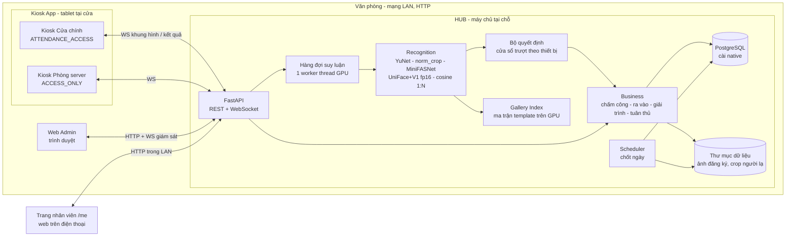
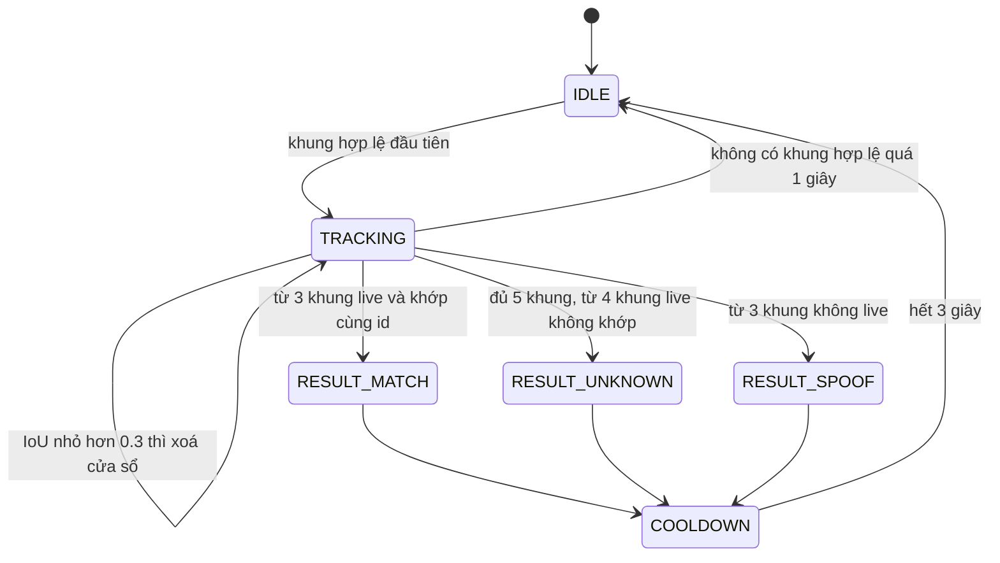
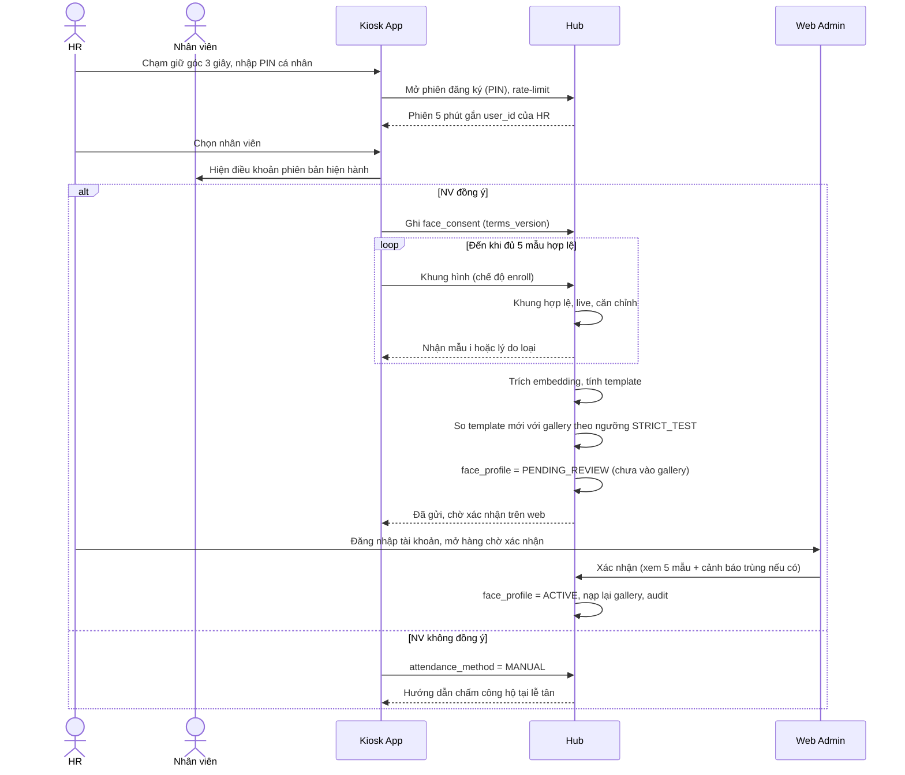
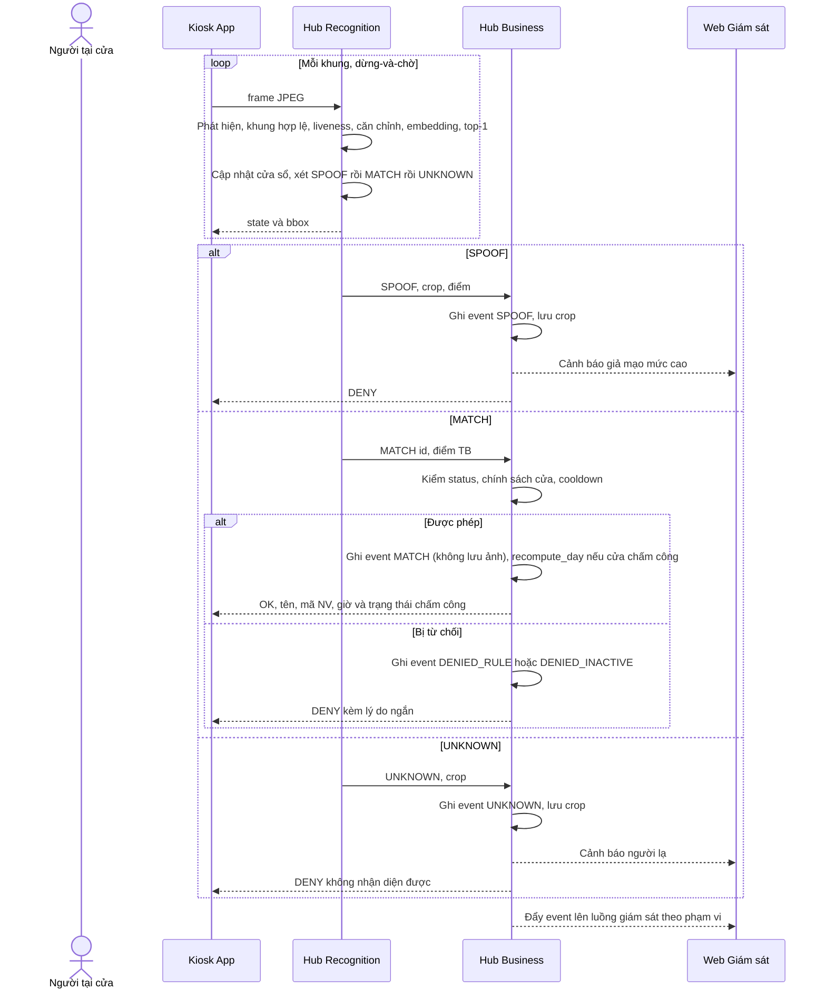
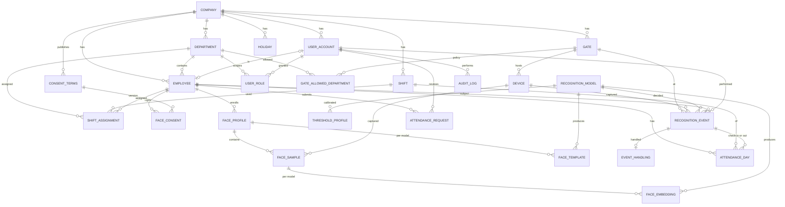

# ĐẶC TẢ APP — HỆ THỐNG CHẤM CÔNG & KIỂM SOÁT RA VÀO BẰNG KHUÔN MẶT (GĐ4)
> ĐATN "Mobile App tích hợp tối ưu AI cho hệ thống điểm danh và kiểm soát ra vào bằng nhận dạng khuôn mặt" — Nguyễn Quốc An, PTIT.
> Phiên bản **1.4.3**, 14/11/2026 (1.4.3: §8 trỏ về `openapi/openapi.yaml` + `ws-protocol.md` làm hợp đồng chính thức; giao diện chi tiết ở `ui/`; 1.4.2:1.4.2: bỏ tính năng So sánh mô hình — chỉ dùng 1 mô hình V1 s3, kết quả so sánh V1/UniFace đã đo nằm trong quyển; 1.4.1: đồng bộ §1.3, §2.1, §9.2, §15 với §0a; 1.4: rút gọn cho bản DEMO — xem §0a; 1.1: sửa §2.2, §2.3, §3, §4.1, M0 theo review vòng 4; 1.2: thêm M0(4b) tái lập BLUFR trial 01 theo review vòng 5; 1.3: An quyết định (4b) chỉ là dự phòng, không chạy trong M0), session thiết kế app. **Đây là tài liệu cuối để code.** Gộp: `de-xuat-tong-the.md` (v2), `thiet-ke-gd3.md`, review `review/2026-11-14_review-thiet-ke-app.md` và `xu-ly-review.md` (vòng 1 + 2). Khi mâu thuẫn, **file này thắng**.
> Quy ước: **[khởi đầu]** = giá trị thiết kế đặt, chỉnh khi kiểm thử; **[chưa đo]** / **[mục tiêu]** = chưa có số đo; **[chờ GVHD]** / **[chờ An]** = phụ thuộc câu trả lời bên ngoài. Mọi con số mô hình đều có nguồn log (mục 4.4).

## 0a. Phạm vi bản DEMO (v1.4 — quyết định An 14/11/2026, ưu tiên hơn mọi mục khác)
App chỉ để **trình diễn trong ĐATN**, không thương mại hoá. Do đó:
| Hạng mục | Bản demo | Thay cho |
|---|---|---|
| Thành phần | **Kiosk App = app mobile native** (Expo, Android). **Trang nhân viên = web responsive** `/me` trong cùng codebase React với Web Admin (không bắt buộc cài PWA) | Employee PWA cài được |
| Mạng | **HTTP trong LAN** (Hub, Kiosk, điện thoại cùng Wi-Fi). Không tên miền, không TLS | §10.2 |
| Đồng ý khuôn mặt | **Một ô "Đồng ý"** trên Kiosk K-07 → ghi `employee.face_consent_at`, `face_consent_by`. Không có bảng/phiên bản điều khoản | `consent_terms`, `face_consent`, W-17 |
| Xoá dữ liệu khuôn mặt | Giữ nút **"Xoá dữ liệu khuôn mặt"** (W-04) và tự xoá khi chuyển `TERMINATED`. Không xác nhận 2 bước | §5.9 |
| Bỏ khỏi demo | log đọc ảnh (`READ_FACE_IMAGE`), BitLocker, job xoá ảnh theo hạn (`retention_days`), audit chi tiết before/after (audit chỉ ghi action + entity), rate-limit/khoá PIN phức tạp (giữ khoá đơn giản sau 5 lần sai), refresh device token | §5.9, §10 |
| Pháp lý, thoả thuận dữ liệu | Không xử lý trong app; quyển chỉ ghi 1 mục "Hạn chế & hướng phát triển" | §10.3, Q5 |
| **Bỏ (v1.4.2)** | Tính năng **So sánh mô hình** (W-15, K-12, `/compare`, mô hình COMPARISON). App chỉ nạp **1 mô hình: UniFace + V1 s3**. So sánh V1 với UniFace/baseline dùng **kết quả đã đo** (BLUFR, CH1/CH2) trình bày trong quyển | §4.1, §4.4, §5.10, W-15, K-12 |
| **Giữ nguyên** | Mô hình V1 s3 + cổng kiểm hash; ngưỡng 0,4233 / 0,4657; cửa sổ trượt; MiniFASNet; chấm công, giải trình, chấm hộ, ra vào, giám sát; người duyệt ≠ người gửi; không hiển thị ảnh trên Kiosk; không lưu crop cho MATCH | — |

Thiết kế DB chi tiết theo bản demo: `03-app/db/thiet-ke-db.md` (thắng §7 khi lệch).

## 0. Mục lục
1. Phạm vi · 2. Kiến trúc & mã nguồn · 3. Môi trường · 4. Pipeline AI · 5. Nghiệp vụ · 6. Vai trò & quyền · 7. Dữ liệu · 8. API · 9. Màn hình · 10. Bảo mật & tuân thủ · 11. Phi chức năng · 12. Mốc & tiêu chí nghiệm thu · 13. Hạn chế đã biết · 14. Lộ trình · 15. Truy vết quyết định

---

## 1. Phạm vi

### 1.1 Sản phẩm
Hệ thống **chấm công + kiểm soát ra vào cho văn phòng doanh nghiệp vừa và nhỏ (10–200 nhân viên, 1 cơ sở, 1–3 cửa)**, triển khai **tại chỗ (on-premise)**: Hub đặt trong văn phòng, ảnh khuôn mặt không rời văn phòng. App là phần **tích hợp/trình diễn** của đề tài; đóng góp nghiên cứu là mô hình UniFace + V1.

### 1.2 Thành phần
| Thành phần | Công nghệ | Người dùng |
|---|---|---|
| **Kiosk App** (mobile) | React Native (Expo dev build) chạy trên tablet/điện thoại Android cố định ở cửa | Người qua cửa; HR khi đăng ký khuôn mặt |
| **Web** (một codebase React) | Hai phần: **Web Admin** (`/admin`) và **trang nhân viên** (`/me`, responsive cho điện thoại) | Chủ DN, HR, Quản lý, Lễ tân/Bảo vệ; Nhân viên |
| **Hub** | FastAPI + PyTorch + PostgreSQL | — |

"Mobile App" trong tên đề tài = **Kiosk App** (native, nơi diễn ra nhận dạng). Trang nhân viên là web responsive (quyết định An, v1.4).

### 1.3 Trong MVP
Ghép Kiosk; đăng ký khuôn mặt có consent + xác nhận trên web; nhận dạng 1:N tại cửa với chống giả mạo thụ động (MiniFASNet); chấm công theo ca cố định, ngày lễ, giải trình, chấm công hộ cho NV không dùng khuôn mặt, xuất Excel tháng; ra vào theo chính sách cửa + danh sách phòng ban; giám sát realtime + cảnh báo người lạ/giả mạo; trang nhân viên (web responsive); dữ liệu khuôn mặt: ô đồng ý, xoá khi nghỉ việc/bấm xoá, audit thao tác (bản demo, §0a).

### 1.4 Ngoài MVP (lộ trình, mục 14)
Thử thách quay đầu; khoá/mở khoá kỳ công; quy tắc ra vào theo khung giờ/ưu tiên; notification push; dashboard biểu đồ; ca qua đêm, tăng ca, nghỉ phép có đơn; PIN cá nhân tại Kiosk; relay/khoá điện thật; đa công ty/đa chi nhánh; mã hoá embedding mức ứng dụng; nhiều mặt cùng lúc; hiệu chỉnh ngưỡng tại chỗ.

---

## 2. Kiến trúc & mã nguồn

### 2.1 Sơ đồ (hình: `so-do/v2/01-kien-truc.png`)


**Nguyên tắc** (giữ từ GĐ3, đã qua review):
1. Toàn bộ AI ở Hub; Kiosk chỉ chụp và hiển thị; gửi khung kiểu **dừng-và-chờ**.
2. **Một worker thread suy luận** nhận việc qua hàng đợi; event loop FastAPI không bao giờ chạy PyTorch trực tiếp (R-21).
3. `recognition_event` là dữ liệu gốc **chỉ thêm**; `attendance_day` là dữ liệu dẫn xuất, tính lại được (`recompute_day`).
4. Dùng lại code thực nghiệm dạng **chỉ-đọc có kiểm hash** (mục 2.3).

### 2.2 Cấu trúc thư mục `03-app/`
```
03-app/
├── dac-ta-app.md                 ← file này
├── hub/
│   ├── pyproject.toml / requirements.lock
│   ├── app/
│   │   ├── main.py               (FastAPI, khởi động worker, nạp model)
│   │   ├── config.py             (pydantic-settings, đọc .env)
│   │   ├── api/                  (router REST theo nhóm mục 8, ws_kiosk.py, ws_monitor.py)
│   │   ├── auth/                 (JWT, RBAC, device token, PIN)
│   │   ├── recog/                (detector.py, liveness.py, embedder.py, gallery.py, decision.py, worker.py)
│   │   ├── biz/                  (attendance.py, access.py, requests.py, enrollment.py, compliance.py, export_excel.py)
│   │   ├── db/                   (models.py SQLAlchemy 2, session.py)
│   │   └── jobs/                 (scheduler.py: finalize_days, purge_snapshots, renew_tls)
│   ├── alembic/
│   ├── vendor/
│   │   ├── code/                 (DATN_CODE_DIR trỏ vào đây)
│   │   │   ├── train.py          (bản sao nguyên văn — CHỈ để thoả find_code_dir, KHÔNG chạy)
│   │   │   └── fr/               (bản sao CHỈ-ĐỌC từ 02-thuc-nghiem/code/fr: backbones, align, eval, utils, align/models/yunet .onnx)
│   │   ├── evaltest/             (bản sao CHỈ-ĐỌC: __init__.py, features.py, common.py)
│   │   ├── manifest/             (manifest_24.json, strip_map_ban_sao.json — bản sao chỉ-đọc, dùng cho cổng khởi động)
│   │   ├── silentface/           (MiniFASNet: mô hình + trọng số, kèm LICENSE Apache-2.0)
│   │   └── MANIFEST.sha256       (sha256 từng file + đường dẫn nguồn gốc)
│   ├── scripts/                  (gen_thresholds.py, parity_features.py, parity_landmarks.py, check_env.py, seed_demo.py)
│   └── tests/                    (unit + integration; test_decision_exhaustive.py, test_color_order.py, test_vendor_hash.py …)
├── web/                          (React 18 + Vite + TS + Ant Design + TanStack Query + React Router; vite-plugin-pwa)
│   └── src/{admin,me,shared}/
├── kiosk/                        (Expo + TS + react-native-vision-camera)
├── openapi/openapi.yaml          (hợp đồng API — An viết trước, mục 8)
├── ket-qua-kiem-thu/<ngày>_<tên>/ (log M0/M1/M7 …, không ghi vào 02-thuc-nghiem/)
└── so-do/ (v1 = GĐ3, v2 = đặc tả này)
```

### 2.3 Dùng lại code thực nghiệm
- Sao **nguyên văn** vào `hub/vendor/`: `02-thuc-nghiem/code/fr/` + `code/train.py` → `vendor/code/`; `02-thuc-nghiem/eval-test/evaltest/{__init__.py, features.py, common.py}` → `vendor/evaltest/`; `eval-test/manifest/manifest_24.json` và `eval-test/tools/windows/logs/strip_map_ban_sao.json` → `vendor/manifest/`. **Không sửa** nội dung; mọi điều chỉnh làm ở lớp bọc `app/recog/`.
- **Thứ tự import bắt buộc:** đặt biến môi trường `DATN_CODE_DIR = <hub>/vendor/code` **trước** khi `import evaltest.features`, vì `features.py` gọi `import_code()` ngay ở cấp module và `find_code_dir` đòi thư mục có **cả** `train.py` lẫn `fr/` (không có → `FileNotFoundError` trước khi lớp bọc kịp chạy). `train.py` chỉ để thoả điều kiện này, không bao giờ được chạy. `evaltest` là package (import tương đối) nên phải có `__init__.py`.
- Vì sao vendor từ `code/`: lần chạy BLUFR dùng `code/` cho cả 24 checkpoint, kể cả V1; manifest ghi codebase train của V1 là `code-v1`, nhưng các file backbone/eval/align/utils của `code/` và `code-v1/` giống hệt (reviewer đã `cmp`).
- `vendor/MANIFEST.sha256` lưu sha256 + đường dẫn gốc. `tests/test_vendor_hash.py` kiểm (a) hash khớp manifest; (b) nếu có `02-thuc-nghiem/` cạnh bên: hash khớp file gốc trong `code/` **và** các file `fr/backbones`, `fr/eval`, `fr/align`, `fr/utils` giống hệt bản tương ứng trong `code-v1/`.
- Hàm được dùng (đã đối chiếu chữ ký thật):
  - `fr.align.detector.YuNetDetector(model_path, score_threshold=0.6, nms_threshold=0.3, top_k=50).detect(img_bgr) → [{'box':(x,y,w,h), 'landmarks':(5,2) float32, 'score'}]`
  - `fr.align.template.norm_crop(img, landmark, image_size=112) → (warped_bgr, M)` — **phải unpack**, ảnh ra là **BGR**.
  - `evaltest.features.load_backbone(path, device, row=…, expected_sha=…) → (backbone, meta)` — tự bật fp16 khi `device.type == "cuda"`, kiểm sha256, nạp `strict=True`, trả `meta.t_eq30` (= b̃/s). **Luôn truyền `row`** = dòng của checkpoint trong `manifest_24.json` (`checkpoints[]`, khoá `id`) để chạy `verify_checkpoint`: kiểm config fingerprint, loại head, `expected_epoch`, `best_metric_value`.
  - `evaltest.features.extract_features(backbone, images_u8, device) → (N,512) float32` — input **`torch.uint8 (N,3,112,112) RGB`**, flip-cộng, L2, amp khi CUDA. **Đây là hàm duy nhất được dùng để trích feature.**
- **Không dùng** `fr.align.pipeline.FaceAligner` (có `fallback_landmarks` của LFW, vô nghĩa với camera).

---

## 3. Môi trường
| Hạng mục | Quy định |
|---|---|
| Máy Hub (demo) | Laptop An: Ryzen 5 5600H, 16 GB RAM, RTX 3050 Laptop 4 GB, Windows 64-bit, ổ trống ~21 GB (12/11/2026) |
| Python / torch / OpenCV | **Cố gắng trùng môi trường BLUFR**: Python 3.13, torch 2.11.0+cu130, OpenCV 4.14.0 (nguồn: `results/2026-11-12_test-blufr-lfw/eval_test/env.json`, `align_summary.opencv`). **Bước đầu M0** kiểm driver RTX 3050 hỗ trợ CUDA 13 (`nvidia-smi`, `torch.cuda.is_available()`). Không được → dùng bản torch CUDA hợp driver, ghi phiên bản thật vào `recognition_model.runtime` và log parity |
| CSDL | PostgreSQL 16 **cài native trên Windows** (không Docker/WSL2, tiết kiệm ổ đĩa) |
| Kiosk build | Expo dev build. Thiếu chỗ cho Android SDK → **EAS Build** (hạn mức gói miễn phí **chưa xác minh**) |
| Dữ liệu cho M0 | Ảnh LFW deep-funneled (cùng nguồn lần chạy BLUFR: Kaggle `jessicali9530/lfw-dataset`, thư mục `lfw-deepfunneled/lfw-deepfunneled`) — chỉ cần cho parity landmark M0(5); **chừa dung lượng** (kiểm kích thước thực khi tải, **[chưa đo]**) và đặt **ngoài** `02-thuc-nghiem/`, vd. `D:\datn-data\lfw` hoặc ổ ngoài; xoá được sau M0 |
| Thư mục dữ liệu Hub | `HUB_DATA_DIR` (bản demo: thư mục thường; BitLocker là hướng phát triển, §0a) |
| TLS | Mục 10.2 |
| Mạng demo | Hub, Kiosk, điện thoại nhân viên cùng Wi-Fi |

Cấu hình qua `.env`: `DATABASE_URL`, `HUB_DATA_DIR`, `MODEL_PROD_PATH`, `MODEL_PROD_SHA256`, `MODEL_CMP_PATH`, `MODEL_CMP_SHA256`, `YUNET_PATH`, `MINIFAS_DIR`, `DATN_CODE_DIR` (= `hub/vendor/code`), `JWT_SECRET`, `TLS_CERT`, `TLS_KEY`, `DNS_API_TOKEN` (bí mật, mục 10.2), `COMPANY_TZ=Asia/Ho_Chi_Minh`.

---

## 4. Pipeline AI

### 4.1 Mô hình dùng trong app
| Vai trò | Run | File | SHA-256 file gốc | Epoch | Nguồn chọn |
|---|---|---|---|---|---|
| **PRODUCTION** | UniFace + V1, R18, seed 3, `best.pt` | `02-thuc-nghiem/results/V1-s3-Hy/phien-1/r18_uniface_v1_lam0.6_m0.45_s3_e28/checkpoints/best.pt` | `120489621accefd7e78da9bd83fe3c6360ad94877e8ac4b9cdfa1038ec8eef88` | 18 | val TAR@FAR=1e-3 cao nhất trong 3 seed (s1 0,78011 · s2 0,77741 · s3 0,78023) |

- Manifest: id `r18_uniface_v1_lam0.6_m0.45_s3_e28:best` (expected_epoch 18, best_metric_value 0,7802327542587283, loss `uniface_v1`) và `r18_uniface_lam0.6_m0.45_s3_e28:best` (expected_epoch 20, best_metric_value 0,7755102040816326, loss `uniface`).
- **Cổng khởi động (mỗi lần Hub chạy — chỉ đọc file/log, luôn tái lập được):**
  1. sha256 file `best.pt` = `sha256` trong dòng manifest (bảng trên).
  2. Trong `strip_map_ban_sao.json` có bản ghi với `source_sha256` = hash ở bước 1 và `dest_sha256` = `meta.sha256` của khoá tương ứng trong `ket_qua_blufr_lfw.json` (V1 s3: `120489…ef88 → b00612f5…a065`). Đây là chuỗi nối checkpoint đang nạp với đúng file đã tạo số liệu BLUFR.
  3. `load_backbone(path, cuda, row=<dòng manifest>, expected_sha=<sha gốc>)` → `verify_checkpoint` pass, `strict=True` không thiếu/thừa khoá.
  4. `meta.t_eq30` = `meta.t_eq30` trong `ket_qua_blufr_lfw.json` (sai số ≤ 1e-6).
  Sai bất kỳ bước nào → Hub dừng khởi động (không chạy với mô hình chưa xác minh).
- **KHÔNG** trích lại backbone ra file rồi so sha256 với `meta.sha256` ở lúc khởi động: `torch.save` không bảo đảm cho cùng từng byte khi khác phiên bản torch/môi trường, nên phép thử đó có thể hỏng dù mô hình đúng.
- **Một lần ở M0** (session code cần được cấp quyền đọc thư mục `C:\datn-backbones-24`, nằm ngoài thư mục dự án): so **tensor** backbone nạp từ `best.pt` với bản trích sẵn ở `C:\datn-backbones-24\<id>/best.pt` bằng `torch.equal` cho mọi khoá (cùng cách `strip_backbone.strip_one` tự kiểm). Lưu log.
- `recognition_model` lưu `source_sha256`, `stripped_sha256` (lấy từ strip_map), id manifest.
- Mô hình train trên CASIA-WebFace (bản insightface, Kaggle) → **chỉ dùng cho nghiên cứu/giáo dục**; UI hiện nhãn "Bản trình diễn nghiên cứu – không dùng thương mại". **[chờ An]** Q5 (thỏa thuận CBSR).

### 4.2 Chuỗi xử lý một khung (Hub)
1. Giải mã JPEG → ảnh **BGR** (OpenCV).
2. `YuNetDetector.detect(img_bgr)` (score ≥ 0,6). Chọn **mặt có bbox lớn nhất** (khác `pick_center_face` của LFW — ghi trong quyển).
3. **Khung hợp lệ** khi: có mặt; cạnh ngắn bbox ≥ 80 px **[khởi đầu]**; `|yaw_ratio| ≤ 0,35` **[khởi đầu]**, với `yaw_ratio = (x_mũi − x_giữa_hai_mắt) / khoảng_cách_hai_mắt` từ 5 landmark.
4. Liveness: MiniFASNet trên ảnh BGR gốc + bbox (crop theo đúng quy ước của mã Silent-Face, **xác minh trong mã gốc ở M7**) → `p_live ∈ [0,1]` (xác suất lớp "thật").
5. `warped_bgr, _ = norm_crop(img_bgr, landmarks)` → `rgb = cv2.cvtColor(warped_bgr, BGR2RGB).transpose(2,0,1)` → tensor uint8 `(1,3,112,112)`.
6. `emb = extract_features(backbone, tensor, cuda)` → (1,512) float32 đã L2.
7. `scores = T · emb` (T = ma trận template gallery, mục 4.6) → `(id*, s*)` = top-1.
8. Đưa `(valid, live, id*, s*, bbox, t)` vào bộ quyết định của thiết bị (4.5).

Ghi chú: flip-cộng làm embedding bất biến với lật gương ⇒ ảnh camera trước lật hay không không ảnh hưởng nhận dạng.

### 4.3 Chế độ số học
fp16 autocast trên CUDA (do `load_backbone`/`extract_features` tự bật), giống điều kiện tạo số liệu BLUFR (`meta.amp = true`). CPU fallback chỉ dùng cho kiểm thử, ghi rõ trong log.

### 4.4 Ngưỡng
Tạo **tự động** bằng `scripts/gen_thresholds.py` đọc thẳng từ log (không gõ tay), ghi vào `threshold_profile` kèm `source_ref`.

| Mức | V1 s3 (PRODUCTION) | Nguồn | Nhãn bắt buộc khi hiển thị |
|---|---|---|---|
| **DEFAULT_VAL** | **0,4233** | `thr@far=1e-05` tại epoch best trong `val.jsonl` của run | "Chọn trên validation (FAR 1e-5)" |
| **STRICT_TEST** | **0,4657** | TB 10 trial `blufr.per_trial[*]["thr_DIR@0.01"]` trong `ket_qua_blufr_lfw.json` | "**Hiệu chỉnh trên tập test BLUFR sau khi đã báo cáo kết quả**" |
| t = b̃/s (chỉ hiển thị, không dùng vận hành) | 0,3736 | `meta.t_eq30` | "Ngưỡng học được của mô hình (CH2)" |
| CUSTOM | nhập tay | — | — | "Tuỳ chỉnh" |

**Kiểm chứng trên BLUFR (gallery 1000 người, TB ± SD 10 trial, nguồn `blufr.CH2_tai_nguong_co_dinh`):**

| Ngưỡng V1 s3 | FPIR | FNIR rank-1 |
|---|---|---|
| DEFAULT_VAL 0,4233 | 5,0% ± 0,7 | 10,6% ± 0,9 |
| STRICT_TEST 0,4657 | 1% (theo định nghĩa — hiệu chỉnh trên chính tập này) | ≈ 16,4% (1 − DIR 83,65%) |
| t = b̃/s 0,3736 | 22,1% ± 1,7 | 6,1% ± 0,6 |

**Mặc định theo loại cửa:** `ATTENDANCE_ACCESS` → DEFAULT_VAL; `ACCESS_ONLY` → STRICT_TEST. Chủ DN đổi được tại W-14.
**Đánh đổi phải nêu trong UI và quyển:** DEFAULT_VAL giảm từ chối nhầm (16,4% → 10,6%) nhưng tăng FPIR trên BLUFR (1% → 5%, ~1/20 người lạ). "Văn phòng ít người hơn 1000 thì FPIR thấp hơn" là **giả định chưa đo** (cần phân phối điểm impostor tại chỗ giống LFW; có lệch miền: người Việt, camera tablet, template 3–5 ảnh).

### 4.5 Bộ quyết định (theo từng thiết bị)
**Định nghĩa trên mỗi khung hợp lệ:** `live = (p_live ≥ L)`; `match = (s* ≥ τ)` — **dùng `≥` cho cả hai**. τ = ngưỡng của cửa; L = ngưỡng liveness (một ngưỡng duy nhất, giá trị khởi đầu chốt ở M7; trước M7 hoặc khi tắt chống giả mạo: `live = true`).

**Cửa sổ:** tối đa **W = 5** khung hợp lệ gần nhất **[khởi đầu]**.
- Khung **không hợp lệ** (không có mặt / không đạt chất lượng) **không vào cửa sổ**; nếu liên tục không có khung hợp lệ > 1,0 s → **xoá cửa sổ**.
- Nếu bbox khung hợp lệ mới có IoU < 0,3 với khung hợp lệ trước → coi là người khác → **xoá cửa sổ** rồi thêm khung mới.
- Sau mỗi kết luận → xoá cửa sổ, vào COOLDOWN hiển thị 3 s.

**Luật kết luận** (xét sau mỗi khung hợp lệ, theo **thứ tự ưu tiên SPOOF > MATCH > UNKNOWN**):
1. **SPOOF**: số khung `¬live` ≥ 3.
2. **MATCH(id)**: tồn tại id có số khung `live ∧ match ∧ id* = id` ≥ 3. Điểm báo cáo = TB s* của các khung đó.
3. **UNKNOWN**: cửa sổ đủ 5 khung **và** số khung `live ∧ ¬match` ≥ 4 **và** không id nào có ≥ 2 khung `live ∧ match`.
4. Không luật nào → tiếp tục.

(Với W = 5, ba luật loại trừ nhau từng đôi vì 3+3, 3+4, 3+4 > 5; thứ tự ưu tiên vẫn cài đặt và kiểm thử.)

**Máy trạng thái** (hình `so-do/v2/04-trang-thai-kiosk.png`):


**Tham số [khởi đầu]** (`company.settings`, Chủ DN chỉnh tại W-14): W = 5; MATCH ≥ 3; UNKNOWN ≥ 4/5; SPOOF ≥ 3; mất mặt 1,0 s; IoU 0,3; cooldown cùng NV cùng cửa 60 s (trong cooldown Kiosk hiện "Đã ghi nhận lúc …", không tạo event); cooldown cảnh báo người lạ mỗi cửa 15 s; Kiosk gửi tối đa 4 khung/s, cạnh dài 640 px, JPEG q = 80; bật/tắt chống giả mạo.

**Kiểm thử bắt buộc** (`tests/test_decision_*.py`, hàm `decide(window, params)` thuần, không đụng mô hình):
- Unit test từng luật, cả **giá trị đúng bằng ngưỡng** (`s* = τ` → match; `p_live = L` → live).
- **Vét cạn**: mọi chuỗi độ dài 1–8 trên bảng chữ cái khung {`INVALID`, `NL` (không live), `LA` (live khớp A), `LB` (live khớp B), `LN` (live không khớp)} — cộng biến thể "mất mặt > 1 s" và "IoU < 0,3" — so kết quả `decide` với một cài đặt tham chiếu viết độc lập; kiểm (a) không bao giờ hai luật cùng đúng mà ra sai ưu tiên, (b) `INVALID` không làm đổi cửa sổ, (c) sau kết luận cửa sổ rỗng.

### 4.6 Gallery
- Thành viên gallery: NV `status = ACTIVE` ∧ `attendance_method = FACE` ∧ consent còn hiệu lực ∧ `face_profile.status = ACTIVE` ∧ có `face_template` của mô hình đang chạy.
- `template = L2(mean(embedding các mẫu))`.
- Nạp lại ma trận lên GPU khi khởi động và khi có thay đổi liên quan (enroll duyệt, xoá, đổi trạng thái NV, rút consent). Thay đổi có hiệu lực **trước** khi API trả về thành công.

---

## 5. Nghiệp vụ

### 5.1 Nhân viên
- `status`: `ACTIVE` · `SUSPENDED` (tạm khoá; giữ dữ liệu; qua cửa → `DENIED_INACTIVE`) · `TERMINATED` (nghỉ việc; mục 5.9).
- `attendance_method`: `FACE` · `MANUAL` (không đồng ý/rút đồng ý; chấm công hộ, mục 5.6).

### 5.2 Đồng ý & đăng ký khuôn mặt (F-02, hình `so-do/v2/02-dang-ky.png`)

- 5 mẫu, gợi ý tư thế: thẳng, hơi trái, hơi phải, hơi ngẩng, hơi cúi **[khởi đầu]**; mẫu phải là khung hợp lệ và live (nếu bật chống giả mạo).
- Cảnh báo trùng: template mới khớp một NV khác ở mức STRICT_TEST → hiện trên W (cả hai tên), người xác nhận chọn Huỷ / Vẫn duyệt (ghi audit, lý do bắt buộc).
- Bản demo (§0a): K-07 hiện đoạn điều khoản ngắn cố định + ô **Đồng ý** → ghi `employee.face_consent_at`, `face_consent_by`. Không có bảng/phiên bản điều khoản.
- Đăng ký lại = tạo profile mới `PENDING_REVIEW`; profile cũ giữ `ACTIVE` đến khi profile mới được duyệt, rồi xoá mẫu cũ.

### 5.3 Nhận dạng tại cửa (F-03, hình `so-do/v2/03-nhan-dang.png`)


### 5.4 Ra vào (sau MATCH)
1. `SUSPENDED` → `DENIED_INACTIVE`. (`TERMINATED` không còn trong gallery.)
2. `gate.default_policy`: `ALLOW_ALL_ACTIVE` (cửa chính) hoặc `DEPARTMENTS_ONLY` → chỉ NV thuộc phòng ban trong `gate_allowed_department`.
3. Được phép → event `MATCH`, `door_action = OPEN` (cửa **mô phỏng**: màn xanh + âm thanh). Không → `DENIED_RULE`.

### 5.5 Chấm công (cửa `ATTENDANCE_ACCESS`, event `MATCH` được phép hoặc `MANUAL_ATTENDANCE`)
- **Ca** (MVP): `start`, `end` cùng ngày, `break_start/break_end`, `grace_in`, `grace_out`. Thời lượng ca ≤ 17 h để cửa sổ hai ngày liền nhau không chồng.
- **Phân ca**: theo phòng ban hoặc cá nhân (cá nhân ưu tiên), ngày trong tuần, hiệu lực từ–đến; **ràng buộc không chồng** bằng exclusion constraint.
- **Ngày lễ**: bảng `holiday` (ngày nghỉ toàn công ty).
- **Gán event vào ngày công** theo **cửa sổ của ca** `[start − 3h, end + 4h]` **[khởi đầu]** (không theo ngày lịch). Event ngoài mọi cửa sổ → chỉ là ra vào.
- `check_in` = event sớm nhất trong cửa sổ. `check_out` = event muộn nhất có thời điểm ≥ `check_in + 30 phút` **[khởi đầu]**.
- **Trạng thái** (xét theo thứ tự):

| Trạng thái | Điều kiện |
|---|---|
| `HOLIDAY` | ngày trong `holiday` (vẫn ghi giờ nếu có event) |
| `LEAVE` | HR đánh dấu nghỉ |
| `OFF` | không có ca |
| `NOT_STARTED` | chưa tới `start`, chưa có event |
| `IN_PROGRESS` | chưa tới thời điểm chốt (`end + 4h`), có check_in |
| `ABSENT` | đã chốt, không có check_in |
| `MISSING_OUT` | đã chốt, có check_in, (không có check_out **hoặc** check_out < `end − 2h` **[khởi đầu]**) — trường hợp sau gắn cờ `suspect_forgot_out` (có thể chỉ ra ăn trưa) |
| `NORMAL` / `LATE` / `EARLY` / `LATE_EARLY` | `late = check_in > start + grace_in`; `early = end − 2h ≤ check_out < end − grace_out` |

- Kèm `late_min`, `early_min`, `worked_min` (trừ nghỉ trưa cố định).
- **Chốt ngày**: Scheduler chạy `finalize_day` lúc `end + 4h` (= cuối cửa sổ). Trước đó trạng thái chỉ là tạm thời; không gửi kết luận "thiếu chấm công" trước thời điểm chốt.
- `recompute_day(employee, work_date)` idempotent: tính từ event + giải trình đã duyệt + holiday/leave. Gọi khi có event mới, khi duyệt giải trình, khi chốt.
- Cửa `ACCESS_ONLY` **không tính công**; E-02 ghi rõ.

### 5.6 Chấm công hộ (NV `MANUAL`)
- Thực hiện tại W-10 bởi Lễ tân/HR/Chủ DN: chọn NV (chỉ NV `MANUAL`), cửa chấm công, lý do bắt buộc → event `MANUAL_ATTENDANCE` thời điểm **hiện tại** (không lùi giờ; sửa giờ đi qua giải trình).
- Người chấm ≠ người được chấm (chặn ở API).
- Báo cáo **số lượt chấm hộ theo từng người chấm** (W-11 lọc `performed_by`, xuất CSV).
- Ghi là **hạn chế đã biết** (13.6).

### 5.7 Giải trình
- Loại: `FORGOT_IN`, `FORGOT_OUT`, `NOT_RECOGNIZED`, `BUSINESS_TRIP`, `OTHER`. Trạng thái: `PENDING → APPROVED | REJECTED | CANCELLED`.
- Người duyệt: Quản lý có `scope_department_id` = phòng ban của người gửi. **Người duyệt ≠ người gửi**: nếu người gửi là Quản lý của chính phòng đó → HR; người gửi là HR → Chủ DN; người gửi là Chủ DN → HR.
- Không ai sửa trực tiếp ngày công của chính mình (API chặn). HR sửa ngày công người khác: bắt buộc lý do → `source = MANUAL`, audit.
- Duyệt → `recompute_day` dùng giờ đề nghị, `source = ADJUSTED`, giữ event gốc.

### 5.8 Xuất bảng công
`GET /attendance/export?month=YYYY-MM` → Excel: sheet "Tổng hợp" (mỗi NV một dòng: ngày công, số lần muộn, tổng phút muộn/về sớm, số ngày vắng, thiếu chấm công, nghỉ) + sheet "Chi tiết" (NV × ngày, giờ vào/ra, trạng thái, nguồn). Không khoá kỳ (lộ trình).

### 5.9 Dữ liệu khuôn mặt (bản demo: xem §0a — bỏ log đọc ảnh, retention job, xác nhận 2 bước)
- **TERMINATED**: HR chuyển trạng thái (xác nhận 2 bước) → **xoá ngay** `face_sample` (file + dòng), `face_embedding`, `face_template`, crop của event có `event_handling.linked_employee_id` = NV; ghi `employee.biometric_deleted_at`, audit. Dữ liệu chấm công giữ.
- **Rút đồng ý** (E-08 hoặc HR thao tác thay): như trên + `attendance_method = MANUAL`.
- **Crop**: chỉ lưu cho `UNKNOWN`/`SPOOF`; xoá sau `retention_days` **[khởi đầu]** 30 ngày. Event `MATCH` không lưu ảnh.
- ~~Log truy cập ảnh~~ — bỏ trong bản demo (§0a).
- **Kiosk K-04 không hiển thị ảnh khuôn mặt**, chỉ tên + mã NV.

### 5.10 ~~So sánh mô hình~~ — **bỏ ở v1.4.2** (§0a)

---

## 6. Vai trò & quyền
Vai trò: `OWNER`, `HR`, `MANAGER` (có `scope_department_id`), `SECURITY`, `EMPLOYEE`; một tài khoản nhiều vai trò. Thiết bị Kiosk xác thực bằng device token (chỉ API của cửa mình).

| Chức năng | OWNER | HR | MANAGER | SECURITY | EMPLOYEE |
|---|---|---|---|---|---|
| Công ty, cửa, thiết bị, cấu hình nhận dạng | W | R | — | R (cửa) | — |
| Tài khoản, vai trò | W | W (trừ OWNER) | — | — | — |
| Nhân viên, phòng ban | W | W | R (team) | R (tên, mã) | R (bản thân) |
| Xác nhận hồ sơ khuôn mặt | W | W | — | — | — |
| Xem mẫu khuôn mặt (có log) | R | R | — | — | — |
| Ca, phân ca, ngày lễ, chính sách cửa | W | W | R (team) | R | R (ca mình) |
| Bảng công, xuất Excel | W | W | R (team) | — | R (bản thân) |
| Sửa ngày công (người khác, có lý do) | W | W | — | — | — |
| Giải trình | duyệt | duyệt | duyệt (team, ≠ bản thân) | — | tạo/huỷ (của mình) |
| Giám sát, cảnh báo, mở cửa thủ công | W | R | — | W | — |
| Chấm công hộ (NV MANUAL, ≠ bản thân) | W | W | — | W | — |
| Tra cứu sự kiện | R | R | R (team) | R | R (bản thân) |
| Nhật ký thao tác | R | — | — | — | — |

"team" = NV thuộc phòng ban `scope_department_id`. Mọi kiểm quyền ở tầng API (không tin client).

---

## 7. Dữ liệu
> **Bản demo: thiết kế DB chính thức là `03-app/db/thiet-ke-db.md` + `schema.sql` (23 bảng, đã chạy thử).** Mục này giữ làm lịch sử; các bảng `consent_terms`, `face_consent` đã bỏ (xem thiet-ke-db.md mục 2).

Hình ERD đầy đủ: `so-do/v2/05-erd.png`. Mọi bảng nghiệp vụ có `id uuid PK`, `company_id uuid FK`, `created_at`, `updated_at` (timestamptz, UTC). `vec512` = `real[]` có CHECK độ dài 512.



| Bảng | Cột (ngoài cột chung) | Ràng buộc / chỉ mục |
|---|---|---|
| `company` | name, timezone, settings jsonb (tham số 4.5, retention_days, anti_spoof_enabled, L) | MVP 1 dòng |
| `department` | name | UNIQUE(company_id, name) |
| `employee` | code, full_name, email?, phone?, department_id, status `ACTIVE/SUSPENDED/TERMINATED`, attendance_method `FACE/MANUAL`, joined_at?, terminated_at?, biometric_deleted_at? | UNIQUE(company_id, code) |
| `user_account` | email, password_hash (argon2id), status, employee_id?, must_change_password, kiosk_pin_hash?, last_login_at | UNIQUE(email); UNIQUE(employee_id) WHERE NOT NULL |
| `user_role` | user_id, role, scope_department_id? | UNIQUE(user_id, role, scope_department_id) — **nguồn sự thật duy nhất** cho "quản lý phòng ban" |
| `consent_terms` | version, content, purpose, retention_text, effective_at | UNIQUE(company_id, version) |
| `face_consent` | employee_id, terms_id, accepted_at, revoked_at?, collected_by_user_id, device_id? | partial UNIQUE(employee_id) WHERE revoked_at IS NULL |
| `face_profile` | employee_id, status `PENDING_REVIEW/ACTIVE/REJECTED/SUPERSEDED`, enrolled_by_user_id, reviewed_by_user_id?, reviewed_at?, duplicate_of_employee_id?, review_note? | partial UNIQUE(employee_id) WHERE status='ACTIVE' |
| `face_sample` | profile_id, image_path (PNG 112×112 RGB đã căn chỉnh), det_score, yaw_ratio, p_live, device_id | INDEX(profile_id) |
| `recognition_model` | code, name, backbone, manifest_id, source_path, source_sha256, stripped_sha256, epoch, t_bs, alignment_version (detector + quy tắc chọn mặt), runtime jsonb (python/torch/opencv/cuda/fp16), is_active | tối đa 1 dòng `is_active` (`ux_model_one_active`); v1.4.2 bỏ cột `role` (khớp `db/schema.sql`) |
| `face_embedding` | sample_id, model_id, vector vec512 | UNIQUE(sample_id, model_id) |
| `face_template` | profile_id, model_id, vector vec512, n_samples | UNIQUE(profile_id, model_id) |
| `threshold_profile` | model_id, level `DEFAULT_VAL/STRICT_TEST/CUSTOM`, cos_threshold, source_ref, label | UNIQUE(model_id, level) WHERE level<>'CUSTOM' |
| `gate` | name, mode `ATTENDANCE_ACCESS/ACCESS_ONLY`, default_policy `ALLOW_ALL_ACTIVE/DEPARTMENTS_ONLY`, threshold_level, custom_threshold?, is_active | UNIQUE(company_id, name) |
| `gate_allowed_department` | gate_id, department_id | PK(gate_id, department_id) |
| `device` | gate_id, name, status `PENDING/ACTIVE/REVOKED`, pairing_code_hash?, pairing_expires_at?, pairing_attempts, token_hash?, token_expires_at?, last_seen_at?, app_version? | UNIQUE(token_hash) |
| `shift` | name, start_time, end_time, break_start?, break_end?, grace_in_min, grace_out_min | CHECK thời lượng ≤ 17 h, end > start |
| `shift_assignment` | shift_id, employee_id? XOR department_id?, weekdays int[], effective daterange | EXCLUDE chồng lấn theo (employee_id, weekday, effective) và (department_id, weekday, effective) — cài bằng bảng con theo weekday hoặc trigger |
| `holiday` | date, name | UNIQUE(company_id, date) |
| `recognition_event` | gate_id, device_id?, occurred_at, result `MATCH/UNKNOWN/SPOOF/DENIED_RULE/DENIED_INACTIVE/MANUAL_OPEN/MANUAL_ATTENDANCE`, employee_id?, model_id?, top1_score?, threshold_used?, threshold_level?, p_live_min?, n_frames?, door_action `OPEN/NONE`, snapshot_path?, performed_by_user_id?, reason? | **Chỉ INSERT** (quyền DB: role ứng dụng không có UPDATE/DELETE trên bảng này, trừ job xoá snapshot_path theo tuân thủ qua hàm SECURITY DEFINER). INDEX(gate_id, occurred_at), (employee_id, occurred_at), (result, occurred_at) |
| `event_handling` | event_id, status `RESOLVED/FALSE_ALARM/IS_EMPLOYEE`, linked_employee_id?, handled_by, handled_at, note | UNIQUE(event_id) |
| `attendance_day` | employee_id, work_date, shift_id?, check_in_at?, check_out_at?, check_in_event_id?, check_out_event_id?, status, suspect_forgot_out bool, late_min, early_min, worked_min, source `AUTO/ADJUSTED/MANUAL`, finalized bool, edited_by?, edit_reason? | UNIQUE(employee_id, work_date); INDEX(work_date) |
| `attendance_request` | employee_id, work_date, type, requested_in?, requested_out?, reason, status, reviewer_user_id?, reviewed_at?, review_note? | INDEX(status); CHECK reviewer ≠ người gửi (kiểm thêm ở API) |
| `audit_log` | actor_user_id?, actor_device_id?, action, entity, entity_id?, before jsonb?, after jsonb?, ip?, at | INDEX(at), (actor_user_id, at) |

Lưu file: `HUB_DATA_DIR/faces/<employee_id>/<profile_id>/<sample_id>.png`, `HUB_DATA_DIR/snapshots/<yyyy-mm-dd>/<event_id>.jpg`. Không lưu khung hình đầy đủ.

---

## 8. API
> **Hợp đồng chính thức (14/11/2026): `openapi/openapi.yaml` (OpenAPI 3.1, 66 path / 77 operation, lint 0 lỗi) + `openapi/ws-protocol.md`.** Khi bảng dưới lệch, hai file đó thắng. Bảng dưới giữ làm tóm tắt lịch sử; các chỗ khác biệt chính: tiền tố `/api/v1`; `ws://` (bản demo); `/me/consent*` → `/me/face*`; không có `/consent-terms`, `/kiosk/token/refresh`; nghỉ việc không cần 2 bước; đăng ký khuôn mặt qua `/kiosk/enrollers` + `/kiosk/enroll/sessions…`; kết quả Kiosk `DENY` kèm `reason`.


**Quy ước:** JSON; lỗi `{"error": {"code": "...", "message": "...", "details": {...}}}`; mã HTTP chuẩn (400 dữ liệu sai, 401 chưa xác thực, 403 không đủ quyền, 404, 409 xung đột, 422 vi phạm quy tắc nghiệp vụ, 429 rate-limit); phân trang `?page=&size=` (≤ 100) trả `{items, total}`; thời gian ISO-8601 có múi giờ.

| Nhóm | Endpoint chính | Quyền |
|---|---|---|
| Xác thực | `POST /auth/login`, `POST /auth/refresh`, `POST /auth/logout`, `POST /auth/change-password` | công khai / đã đăng nhập |
| Bản thân | `GET /me`, `GET /me/today`, `GET /me/attendance?month=`, `GET /me/days/{date}`, `GET/POST /me/requests`, `POST /me/requests/{id}/cancel`, `GET /me/consent`, `POST /me/consent/revoke` | EMPLOYEE |
| Nhân viên | `GET/POST /employees`, `GET/PATCH /employees/{id}`, `POST /employees/{id}/suspend`, `POST /employees/{id}/terminate` (2 bước: `?confirm_token=`) | OWNER, HR (MANAGER đọc team) |
| Phòng ban, tài khoản | `GET/POST/PATCH /departments`, `GET/POST/PATCH /users`, `PUT /users/{id}/roles`, `PUT /users/{id}/kiosk-pin` | OWNER, HR |
| Khuôn mặt | `GET /face-profiles?status=PENDING_REVIEW`, `GET /face-profiles/{id}` (mẫu → ghi log đọc), `POST /face-profiles/{id}/approve`, `POST /face-profiles/{id}/reject`, `DELETE /employees/{id}/biometrics` | OWNER, HR |
| Điều khoản | `GET/POST /consent-terms` | OWNER |
| Cửa, thiết bị | `GET/POST/PATCH /gates`, `PUT /gates/{id}/allowed-departments`, `GET/POST /devices` (trả mã ghép + QR), `POST /devices/{id}/revoke` | OWNER |
| Kiosk | `POST /kiosk/pair` (công khai, rate-limit 5 lần/mã rồi khoá), `POST /kiosk/token/refresh`, `POST /kiosk/enroll/session` (PIN cá nhân HR, rate-limit) | device token |
| Ca, lịch | `GET/POST/PATCH /shifts`, `GET/POST/DELETE /shift-assignments`, `GET/POST/DELETE /holidays` | OWNER, HR |
| Chấm công | `GET /attendance/days?from=&to=&department_id=&employee_id=`, `PATCH /attendance/days/{id}` (lý do), `POST /attendance/leave`, `GET /attendance/export?month=`, `POST /attendance/manual` (chấm công hộ) | theo mục 6 |
| Giải trình | `GET /attendance/requests?status=`, `POST /attendance/requests/{id}/approve`, `POST /attendance/requests/{id}/reject` | OWNER, HR, MANAGER |
| Sự kiện | `GET /events?...` (lọc gate/result/employee/performed_by/thời gian), `GET /events/{id}/snapshot` (log đọc), `POST /events/{id}/handle`, `POST /gates/{id}/manual-open` (lý do) | theo mục 6 |
| Cấu hình | `GET/PUT /settings/recognition` (mức ngưỡng theo cửa, tham số 4.5, L, bật/tắt chống giả mạo, retention) | OWNER |
| Mô hình | `GET /models`, `GET /models/thresholds` | OWNER |
| Audit | `GET /audit-logs?...` | OWNER |
| Hệ thống | `GET /health` (DB, GPU, model hash OK, gallery size), `GET /version` | công khai (không lộ chi tiết nhạy cảm) |

**WebSocket Kiosk** `wss://…/ws/kiosk` — xác thực bằng **message đầu tiên** `{type:"auth", device_token}` (không đặt token trong URL).

| Chiều | Thông điệp |
|---|---|
| K → H | `{type:"frame", seq, mode:"recognize"/"enroll"}` + khung nhị phân JPEG kế tiếp |
| H → K | `{type:"state", seq, state:"NO_FACE"/"TOO_FAR"/"LOOK_STRAIGHT"/"HOLD_STILL"/"CHECKING", bbox?}` |
| H → K | `{type:"result", seq, result:"OK"/"DENY"/"ALREADY", employee?{name, code}, attendance?{kind:"IN"/"OUT"/"NONE", time, status}, door:"OPEN"/"DENY", message}` |
| H → K | `{type:"enroll_progress", accepted, total, reason?}`, `{type:"enroll_done", profile_status:"PENDING_REVIEW"}` |
| H → K | `{type:"config", gate:{name, mode}, research_banner:true}`, `{type:"error", code}` |

Kiosk chỉ gửi khung tiếp theo sau khi nhận `state` hoặc `result` của khung trước.

**WebSocket giám sát** `wss://…/ws/monitor` — auth bằng message đầu `{type:"auth", access_token}`; chỉ đẩy dữ liệu trong phạm vi vai trò: `{type:"event"}`, `{type:"alert"}`, `{type:"device_status"}`.

---

## 9. Màn hình
> Bố cục chi tiết từng màn, dữ liệu, trạng thái và chuyển động: `ui/man-hinh/{kiosk,me,admin}.md`; phong cách: `ui/design-system.md`.


### 9.1 Kiosk App (tablet ngang)
| Mã | Màn hình | Nội dung |
|---|---|---|
| K-01 | Ghép thiết bị | Quét QR / nhập mã 6 số + địa chỉ Hub; lỗi rõ ràng (hết hạn, sai mã, bị khoá, không kết nối) |
| K-02 | Chờ quét | Camera toàn màn hình, khung oval, tên cửa, đồng hồ, chỉ báo kết nối, gợi ý theo `state`, **nhãn "Bản trình diễn nghiên cứu"** |
| K-04 | Kết quả | Xanh: **tên + mã NV** (không ảnh) + "Vào 08:02 · Đúng giờ" / "Ra 17:35" / "Mời vào"; Đỏ: "Không nhận diện được" / lý do; Cam: "Đã ghi nhận lúc …". Âm thanh khác nhau, 3 s |
| K-05 | Đăng nhập HR | Chạm giữ góc 3 s → PIN cá nhân |
| K-06 | Chọn nhân viên | Tìm theo tên/mã; trạng thái hồ sơ (chưa có / chờ duyệt / đang dùng) |
| K-07 | Điều khoản | Đoạn điều khoản ngắn cố định; **Đồng ý / Không đồng ý** (không đồng ý → `MANUAL`, hướng dẫn chấm công hộ) |
| K-08 | Chụp đăng ký | Tiến độ 1/5…5/5, gợi ý tư thế, lý do loại mẫu |
| K-09 | Đã gửi | "Đã gửi, chờ xác nhận trên hệ thống quản trị" |
| K-11 | Mất kết nối | Thông báo + tự thử lại |

### 9.2 Trang nhân viên (`/me`, web responsive trên điện thoại dọc)
| Mã | Màn hình | Nội dung |
|---|---|---|
| E-01 | Đăng nhập | Lần đầu bắt đổi mật khẩu |
| E-02 | Hôm nay | Ca hôm nay, **giờ vào / giờ ra hoặc "Chưa chấm công"**, trạng thái tạm thời/đã chốt, các lượt qua cửa; ghi chú "cửa X không tính công" |
| E-03 | Bảng công tháng | Lịch tô màu + tổng hợp |
| E-04 | Chi tiết ngày | Giờ, nguồn, event, cờ nghi quên quét, nút Giải trình |
| E-05 | Gửi giải trình | Loại, giờ đề nghị, lý do |
| E-06 | Giải trình của tôi | Trạng thái, huỷ khi còn chờ |
| E-08 | Dữ liệu khuôn mặt | Trạng thái hồ sơ, thời điểm đã đồng ý, **Rút đồng ý** (cảnh báo hệ quả) |
| E-10 | (Quản lý) Duyệt giải trình | Danh sách team, không gồm của chính mình |

### 9.3 Web Admin (`/admin`)
| Mã | Màn hình | Vai trò | Nội dung |
|---|---|---|---|
| W-01 | Đăng nhập | tất cả | |
| W-02 | Tổng quan | OWNER, HR | Thẻ số hôm nay (có mặt/muộn/chưa đến/người lạ), 10 event mới nhất |
| W-03 | Nhân viên | OWNER, HR | Lọc phòng ban/trạng thái/phương thức/hồ sơ khuôn mặt; tạo, sửa, tạm khoá, **nghỉ việc (2 bước, xoá sinh trắc)** |
| W-04 | Chi tiết NV | OWNER, HR | Thông tin · Khuôn mặt (consent, mẫu — ghi log khi mở) · Ca · Chấm công · Event |
| W-05 | Phòng ban & tài khoản | OWNER, HR | Phòng ban; tài khoản, vai trò + phạm vi, PIN Kiosk |
| W-06 | Ca, phân ca, ngày lễ | OWNER, HR | |
| W-07 | Cửa & thiết bị | OWNER | Chế độ, chính sách, phòng ban được phép, mức ngưỡng; thêm thiết bị (QR); trạng thái; thu hồi |
| W-08 | Hàng chờ xác nhận khuôn mặt | OWNER, HR | 5 mẫu, cảnh báo trùng, Duyệt/Từ chối |
| W-09 | Bảng công | OWNER, HR, MANAGER (R) | Lưới NV × ngày; sửa có lý do (không với bản thân); nghỉ; xuất Excel |
| W-10 | Giám sát | SECURITY, OWNER, HR (R) | Luồng event realtime, cảnh báo chưa xử lý (crop — log khi mở), xử lý cảnh báo, mở cửa thủ công, **chấm công hộ** |
| W-11 | Tra cứu sự kiện | OWNER, HR, SECURITY, MANAGER (team) | Lọc mọi trường; **báo cáo chấm hộ theo người chấm**; xuất CSV |
| W-12 | Giải trình | OWNER, HR, MANAGER | Chờ duyệt / lịch sử |
| W-14 | Cấu hình nhận dạng | OWNER | Mức ngưỡng theo cửa (hiện số cos, **nhãn nguồn**, bảng đánh đổi 4.4), tham số 4.5, L, bật/tắt chống giả mạo, retention |
| W-16 | Nhật ký thao tác | OWNER | |
| ~~W-17~~ | ~~Điều khoản dữ liệu~~ | — | Bỏ trong bản demo (§0a) |

---

## 10. Bảo mật & tuân thủ

### 10.1 Xác thực, phiên
argon2id; JWT access 15 phút + refresh 7 ngày (xoay vòng, thu hồi khi đổi mật khẩu); PIN Kiosk riêng từng HR (hash, khoá sau 5 lần sai trong 15 phút); device token 30 ngày + refresh, thu hồi được; rate-limit `/auth/login`, `/kiosk/pair`, PIN; CORS chỉ cho origin của Web.

### 10.2 TLS — **bản demo: HTTP trong LAN** (§0a). Nội dung dưới giữ làm hướng phát triển
- **Phương án chính:** tên miền thật, bản ghi `hub.<tên-miền>` trỏ về IP LAN của Hub; chứng chỉ **Let's Encrypt qua DNS-01**; Scheduler tự gia hạn. **`DNS_API_TOKEN` là bí mật**: chỉ trong `.env` trên Hub (quyền file hạn chế), quyền token tối thiểu (chỉ sửa bản ghi TXT của zone đó). Biết trước: tên `hub.<tên-miền>` xuất hiện công khai trong nhật ký Certificate Transparency. **Thử ở M1**: router/DNS chặn phản hồi IP nội bộ (DNS rebinding protection).
- **Dự phòng (chỉ demo):** mkcert; Kiosk đóng gói CA; cài CA thủ công trên 1–2 điện thoại demo. Ghi là hạn chế, không dùng cho bản thương mại.
- Không có chế độ HTTP trong bản giao.

### 10.3 Tuân thủ — **bản demo rút gọn theo §0a**; nội dung dưới là hướng phát triển
Đã thiết kế: consent có phiên bản + lưu nội dung điều khoản; rút đồng ý; xoá sinh trắc khi nghỉ việc; phương án không sinh trắc (chấm công hộ); HTTPS; BitLocker + quyền thư mục; RBAC theo phạm vi; audit thao tác ghi + log đọc ảnh; retention crop; không lưu ảnh cho MATCH; không hiển thị ảnh trên Kiosk.
**[chờ An]** Đọc nguyên văn Luật và Nghị định trước khi trích vào quyển (review mới đọc bản tóm tắt); xuất "hồ sơ xử lý dữ liệu" phục vụ DPIA là lộ trình.

---

## 11. Phi chức năng (mục tiêu — đo ở M1, M7)
| Chỉ tiêu | Mục tiêu | Cách đo |
|---|---|---|
| Thời gian xử lý 1 khung tại Hub (YuNet + MiniFASNet + R18 flip, RTX 3050) | < 150 ms p95 **[mục tiêu]** | log từng bước, p50/p95, 1 và 3 Kiosk giả lập |
| Từ lúc đứng trước camera đến kết quả (NV đã đăng ký) | < 2 s **[mục tiêu]** | đo trên Kiosk |
| Đồng thời | 3 Kiosk + 5 người dùng web **[mục tiêu]** | script giả lập |
| VRAM / RAM Hub | ghi số đo **[chưa đo]** | `torch.cuda.max_memory_allocated`, Task Manager |
| Khôi phục | Hub khởi động lại → nạp model, kiểm hash, nạp gallery tự động | kiểm thử thủ công |

---

## 12. Mốc & tiêu chí nghiệm thu
Kết quả kiểm thử lưu ở `03-app/ket-qua-kiem-thu/<ngày>_<mốc>/` (config + log + bảng). Không ghi số không có log.

| Mốc | Nội dung | Tiêu chí nghiệm thu (đo được) |
|---|---|---|
| **M0 — Nền tảng & parity** | (1) `check_env.py`: driver, CUDA, torch, OpenCV; (2) vendor (gồm `vendor/code/train.py`, `evaltest/__init__.py`, manifest) + `MANIFEST.sha256` + đặt `DATN_CODE_DIR`; (3) nạp mô hình V1 s3 qua cổng khởi động §4.1 + so tensor một lần; (4) parity feature (lớp bọc); (4b) **[dự phòng, không chạy trong M0 — quyết định An 14/11]** tái lập đầu-cuối BLUFR trial 01 cho V1 s3 (căn chỉnh toàn LFW kiểu `pick_center_face` → `extract_features` → `evaltest.blufr.evaluate_trial` trên `data_splits/lfw_blufr/split_t01.csv`); (5) parity landmark (cần tải LFW, §3); (6) test kênh màu; (7) `gen_thresholds.py` | (1) log phiên bản thật; (2) `test_vendor_hash` pass, `import evaltest.features` chạy được trong môi trường sạch chỉ có `vendor/`; (3) 4 bước cổng khởi động pass; `torch.equal` = True cho mọi khoá so với bản trích ở `C:\datn-backbones-24`; (4) cùng laptop, cùng ảnh: Hub (lớp bọc) so với gọi trực tiếp `extract_features` → max abs Δ ≤ 1e-5; so với feature LFW của lần chạy Kaggle (nếu có file feature) hoặc trích lại trên ảnh đã căn chỉnh: cos ≥ 0,9999 **[khởi đầu]**; (4b) [chỉ khi An yêu cầu chạy] so `per_trial["split_t01.csv"]` của V1 s3: thr_DIR@0.01 = 0,46859, DIR_rank1@FPIR 1e-2 = 0,83278, VR@FAR 1e-3 = 0,97844 — |Δthr| ≤ 1e-3, |ΔDIR|, |ΔVR| ≤ 0,5 điểm % **[khởi đầu]**; ghi là chạy lại trên test đã mở để kiểm tái lập, không phải kết quả mới; `aligned_sha256` (38d3fc75…) chỉ ghi nhận, không tính đạt; (5) landmark YuNet trên LFW so `results/2026-11-05_eval-lfw/align_log.csv` ở chế độ `pick_center_face`: ≥ 99% ảnh lệch ≤ 0,5 px; ghi riêng số ảnh khác khi đổi sang "mặt lớn nhất"; (6) đưa ảnh BGR thay RGB → kỳ vọng cos với RGB < 0,99; nếu ≥ 0,99 thì ghi số đo + đề xuất test khác (mô hình ít nhạy kênh màu, không phải lỗi); (7) giá trị = bảng 4.4, có `source_ref` |
| **M1 — Hub nhận dạng** | Pipeline 4.2, worker thread, Gallery, bộ quyết định 4.5, WS Kiosk, `openapi.yaml`, `/health` (HTTP LAN) | `test_decision_exhaustive` pass; Kiosk giả lập (script phát video/ảnh) nhận đúng `state/result`; event loop không bị chặn khi suy luận (đo độ trễ `/health` dưới tải); số đo bảng 11 có log |
| **M2 — Kiosk App** | K-01…K-11 | Ghép bằng QR; quét → kết quả hiển thị ≤ mục tiêu bảng 11 (ghi số đo); đăng ký 5 mẫu → hồ sơ `PENDING_REVIEW`; mất mạng → K-11 và tự nối lại |
| **M3 — Web Admin lõi & tuân thủ** | Auth, vai trò, NV, phòng ban, W-08 xác nhận khuôn mặt, cửa/thiết bị, cấu hình, **nghỉ việc / xoá dữ liệu khuôn mặt** | Test quyền theo ma trận mục 6 (tự động, mỗi ô ít nhất 1 test); TERMINATED hoặc bấm xoá → file và dòng sinh trắc biến mất, gallery cập nhật, audit có bản ghi |
| **M4 — Chấm công** | Ca, phân ca (exclusion), ngày lễ, `recompute_day`, `finalize_day`, giải trình (người duyệt ≠ người gửi), chấm công hộ, xuất Excel | Bộ test kịch bản biên: đi muộn, về sớm, ra ăn trưa quên quét (→ MISSING_OUT + cờ), đến sớm > 3 h, ngày lễ, không ca, giải trình duyệt/từ chối, quản lý tự gửi (→ chuyển HR), chấm hộ cho chính mình (→ 403), event sau chốt; Excel mở được và khớp DB |
| **M5 — Ra vào & giám sát** | Chính sách cửa, `DENIED_*`, W-10, W-11, cảnh báo, mở cửa thủ công, báo cáo chấm hộ | Event đúng `result` theo kịch bản; cảnh báo xuất hiện trên W-10 ≤ 1 s sau event **[mục tiêu]**; SECURITY không thấy dữ liệu ngoài phạm vi |
| **M6 — Trang nhân viên** | E-01…E-10 | Hiển thị đúng trên điện thoại (responsive); E-02 đúng với DB; quản lý không thấy giải trình của chính mình trong E-10 |
| **M7 — Chống giả mạo** | MiniFASNet (xác minh crop theo mã gốc + LICENSE), hiệu chỉnh L, cờ bật/tắt | Bộ thử nội bộ (ảnh thật / ảnh in / màn hình điện thoại / video phát lại, người tình nguyện có đồng ý): bảng tỉ lệ chặn/cho qua **ghi là kiểm thử chức năng**, không phải kết quả nghiên cứu; L chốt kèm log |

---

## 13. Hạn chế đã biết (đưa vào quyển)
1. **Mô hình** train trên CASIA-WebFace (nghiên cứu/giáo dục) → không dùng thương mại; thương mại cần train lại trên dữ liệu có giấy phép. **[chờ An]** Q5.
2. **Ngưỡng** DEFAULT_VAL chọn trên validation CASIA, kiểm trên BLUFR (người nổi tiếng, ảnh web, gallery 1000); điều kiện văn phòng (người Việt, camera tablet, template 3–5 ảnh) **chưa đo**; STRICT_TEST hiệu chỉnh trên test sau khi báo cáo.
3. **Chống giả mạo** dùng MiniFASNet có sẵn (bản nhẹ mở mã), không chống được tấn công có chủ đích (video chất lượng cao, mặt nạ 3D); chỉ kiểm thử chức năng; không phải đóng góp nghiên cứu.
4. **Chọn mặt lớn nhất** khác `pick_center_face` dùng khi đánh giá LFW; căn chỉnh (`norm_crop`) giống hệt.
5. **Cửa mô phỏng**, không điều khiển khoá thật.
6. **Chấm công hộ** có thể bị lạm dụng (lễ tân chấm cho người quen); giảm thiểu bằng ràng buộc người chấm ≠ người được chấm, chỉ cho NV MANUAL, audit và báo cáo theo người chấm.
7. **Ca** không qua nửa đêm; không tăng ca; giờ làm trừ nghỉ trưa cố định.
8. **Bản demo chạy HTTP trong LAN**, không mã hoá đường truyền; consent và quản lý dữ liệu khuôn mặt rút gọn (§0a). Bản thực tế cần HTTPS và quy trình tuân thủ Luật 91/2025/QH15.
9. Một Hub, một công ty, không dự phòng khi Hub hỏng.
10. **Không tái lập số liệu BLUFR trên laptop Hub** (quyết định An 14/11/2026): độ tin cậy dựa trên vendor nguyên văn có kiểm hash, cổng khởi động (sha → strip_map → `verify_checkpoint` → `t_eq30`), parity landmark và test kênh màu. Rủi ro còn lại: điểm cos lệch nhẹ do khác GPU/phiên bản thư viện (T4 + torch 2.11 so với RTX 3050), **chưa đo**. Phương án kiểm khi cần: M0(4b).

## 14. Lộ trình (chỉ thiết kế)
Thử thách chủ động (gắn danh tính, chuỗi hướng ngẫu nhiên) · camera hồng ngoại/độ sâu · khoá kỳ công · quy tắc ra vào theo khung giờ/ưu tiên · khách mời QR · relay/khoá điện · ca qua đêm, tăng ca, đơn nghỉ phép, kết nối phần mềm lương · PIN cá nhân tại Kiosk · push notification · dashboard · hiệu chỉnh ngưỡng tại chỗ từ dữ liệu vận hành · nhiều mặt cùng lúc · pgvector khi gallery lớn · SaaS đa công ty/đa chi nhánh · hồ sơ DPIA tự động · mã hoá embedding mức ứng dụng · huấn luyện lại trên dữ liệu có giấy phép thương mại (thay mô hình qua model registry).

## 15. Truy vết quyết định
| Quyết định | Nguồn |
|---|---|
| Lĩnh vực, on-premise, 4 thành phần | `de-xuat-tong-the.md` §1–2 |
| Checkpoint V1 s3 (v1.4.2: bỏ UniFace s3 đối chứng) | `xu-ly-review.md` Q7; `de-xuat-tong-the.md` §10 |
| Ngưỡng DEFAULT_VAL 0,4233, STRICT_TEST 0,4657, theo loại cửa | `xu-ly-review.md` Q1, V2-1; review R-13 |
| fp16, `load_backbone`/`extract_features`, BGR→RGB | Q8, R-04 |
| Mặt lớn nhất, không dùng FaceAligner | Q9, R-14 |
| Cửa sổ trượt, một ngưỡng L, ưu tiên SPOOF > MATCH > UNKNOWN, `≥`, khung INVALID | R-05, V2-3a/b, góp ý vòng 3 (chi tiết test) |
| Bỏ thử thách quay đầu | Q6, R-06 |
| HTTPS, Let's Encrypt DNS-01, bảo vệ token, CT log | Q2, V2-2, góp ý vòng 3 |
| TERMINATED xoá sinh trắc; SUSPENDED | Q3, R-02 |
| MANUAL + chấm công hộ + báo cáo | Q4, V2-4, R-08 |
| Trang nhân viên là web responsive; cắt phạm vi; bản demo HTTP + rút gọn tuân thủ | Q6, R-20, V2-6; **quyết định An v1.4 (§0a)** |
| PENDING_REVIEW, PIN cá nhân | Q11, R-18 |
| Người duyệt ≠ người gửi | R-09 |
| Cửa sổ ca, chốt end+4h, ngày lễ, cờ quên quét | R-10, R-16 |
| Bỏ So sánh mô hình (W-15) — dùng kết quả đã đo trong quyển | R-11; quyết định An v1.4.2 |
| Ràng buộc/chỉ mục, event_handling, không ảnh trên Kiosk, không crop MATCH | R-17 |
| Worker thread, Postgres native, CUDA 13 kiểm ở M0 | R-21, V2-5 |
| Lưu điều khoản, log đọc ảnh | R-22 |
| FPIR 22,1% tại b̃/s (TB 10 trial) | R-01 |
| Cổng khởi động đọc log (không trích lại so byte); so tensor một lần ở M0; vendor `train.py` + `__init__.py` + `DATN_CODE_DIR`; truyền `row` manifest; nguồn LFW cho M0 | Review vòng 4 (14/11), đã tự kiểm lại trong mã `evaltest/common.py`, `features.py`, `strip_backbone.py`, `manifest_24.json` |
