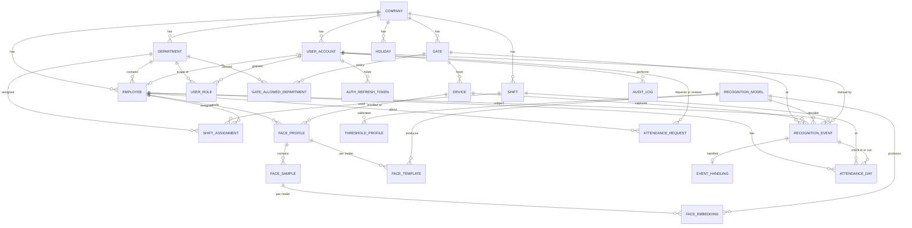

# THIẾT KẾ CƠ SỞ DỮ LIỆU — BẢN DEMO
> ĐATN "Mobile App tích hợp tối ưu AI cho hệ thống điểm danh và kiểm soát ra vào bằng nhận dạng khuôn mặt" — Nguyễn Quốc An, PTIT.
> Phiên bản 1.1, 14/11/2026, session thiết kế app (1.1: bỏ So sánh mô hình — chỉ 1 mô hình V1 s3). Theo `03-app/dac-ta-app.md` **v1.4.2** (§0a bản demo). **Khi lệch với §7 đặc tả, file này thắng.**
> Hệ quản trị: **PostgreSQL 16**. File đi kèm: `schema.sql` (DDL tham chiếu), `seed.sql` (dữ liệu demo, sinh bởi `gen_seed.py`), `test_constraints.sql` (44 ca kiểm ràng buộc), `erd/*.png`.
> **Đã chạy thử** trên PostgreSQL 16 (14/11/2026): `schema.sql` tạo 23 bảng không lỗi; `seed.sql` nạp đủ; `test_constraints.sql` **44/44 ca đạt** (chạy lại sau v1.1: vẫn 44/44), và mọi ca "phải lỗi" bị chặn đúng bởi ràng buộc/trigger dự định (đã đọc thông báo lỗi từng ca).

---

## 1. Nguyên tắc thiết kế
1. **Sự kiện là dữ liệu gốc, ngày công là dữ liệu dẫn xuất.** `recognition_event` chỉ thêm (trigger cấm DELETE, cấm UPDATE trừ việc xoá đường dẫn ảnh). `attendance_day` luôn tính lại được từ sự kiện + giải trình đã duyệt + ngày lễ (`recompute_day` ở tầng ứng dụng).
2. **Ràng buộc nghiệp vụ quan trọng đặt ngay trong DB** (không chỉ ở API): không lưu ảnh cho người đã nhận ra; người duyệt ≠ người gửi; không chồng phân ca; tối đa 1 hồ sơ khuôn mặt đang dùng/đang chờ mỗi NV; tối đa 1 mô hình PRODUCTION đang bật; embedding đúng 512 chiều.
3. **Truy vết mô hình:** mỗi event lưu `model_id`, `top1_score`, `threshold_used`, `threshold_level`. Mỗi ngưỡng lưu `source_ref` (file log + trường). Mô hình lưu cả `source_sha256` và `stripped_sha256`.
4. **Một mô hình đang chạy:** bản demo chỉ nạp UniFace + V1 s3; embedding/template vẫn có `model_id` để đổi mô hình về sau.
5. **Đa công ty để sẵn:** mọi bảng nghiệp vụ có `company_id` (bản demo 1 công ty). `recognition_model`, `threshold_profile` là bảng toàn cục.
6. **Quy ước:** khoá chính `uuid` (`gen_random_uuid()`), trừ `audit_log` (`bigserial`) và các bảng nối/khoá ghép. Thời điểm `timestamptz` lưu UTC, hiển thị theo `company.timezone`. Enum = `text` + `CHECK` (dễ đổi bằng Alembic hơn kiểu ENUM). Bảng có `updated_at` tự cập nhật bằng trigger `set_updated_at`.
7. **Vector:** `real[]` 512 phần tử (CHECK độ dài). Không dùng pgvector: gallery ≤ vài trăm người nạp lên GPU và so khớp bằng phép nhân ma trận; pgvector để lộ trình.
8. **Không có trong DB:** khung hình camera; ảnh khuôn mặt (chỉ lưu đường dẫn file, file nằm trong `HUB_DATA_DIR`).

## 2. Thay đổi so với §7 đặc tả (do bản demo, §0a)
| Thay đổi | Lý do |
|---|---|
| Bỏ `consent_terms`, `face_consent` → thêm `employee.face_consent_at`, `employee.face_consent_by` | Đồng ý = một ô "Đồng ý" trên Kiosk |
| Bỏ `notification` | Ngoài MVP |
| Thêm `auth_refresh_token` | Cần để xoay vòng/thu hồi refresh token (§10.1) |
| `face_consent` → `face_profile` có thêm `enrolled_device_id`, `duplicate_score` | Lưu cảnh báo trùng lúc đăng ký |
| `shift_assignment`: **một dòng mỗi thứ** (`weekday` 1–7) + cột sinh `effective` (daterange) | Để dùng EXCLUDE (btree_gist) chống chồng lấn ngay trong DB |
| `threshold_profile` chỉ DEFAULT_VAL / STRICT_TEST; ngưỡng tuỳ chỉnh nằm ở `gate.custom_threshold` | Ngưỡng tuỳ chỉnh là của từng cửa, không phải của mô hình |
| `audit_log`: `detail jsonb` thay cho `before/after` | Bản demo chỉ cần action + entity |
| `user_account`: thêm `pin_failed_count`, `pin_locked_until` | Khoá PIN đơn giản sau 5 lần sai |
| `recognition_model`: **bỏ cột `role`** (PRODUCTION/COMPARISON); ràng buộc **tối đa 1 mô hình `is_active`** | v1.4.2 bỏ So sánh mô hình; giữ bảng để sau này đổi mô hình không phải sửa app |

## 3. ERD
**Tổng quan quan hệ** (`erd/00-tong-quan.png`):


**Chi tiết theo nhóm** — 4 hình có đủ cột ở `erd/01-to-chuc.png`, `erd/02-khuon-mat.png`, `erd/03-cua-su-kien.png`, `erd/04-cham-cong.png` (Mermaid nguồn ở Phụ lục A).

## 4. Từ điển dữ liệu
Ký hiệu: **PK** khoá chính · **FK→** khoá ngoại · **U** duy nhất · **NN** not null · **CK** check. Cột `created_at`/`updated_at` (timestamptz, NN, mặc định `now()`) có ở mọi bảng trừ khi ghi khác, không lặp lại trong bảng.

### 4.1 Nhóm Tổ chức & phân quyền
**`company`** — công ty (demo: 1 dòng)
| Cột | Kiểu | Ràng buộc | Ý nghĩa |
|---|---|---|---|
| id | uuid | PK | |
| name | text | NN | |
| timezone | text | NN, mặc định `Asia/Ho_Chi_Minh` | múi giờ hiển thị và tính ngày công |
| settings | jsonb | NN | tham số §4.5 (cửa sổ, cooldown…), `anti_spoof_enabled`, `liveness_threshold`, tham số chấm công, `research_banner` (xem mục 6) |

**`department`** — phòng ban · `UNIQUE(company_id, name)`
| Cột | Kiểu | Ràng buộc | Ý nghĩa |
|---|---|---|---|
| id | uuid | PK | |
| company_id | uuid | FK→company, NN | |
| name | text | NN | |

**`employee`** — nhân viên · `UNIQUE(company_id, code)` · INDEX(department_id)
| Cột | Kiểu | Ràng buộc | Ý nghĩa |
|---|---|---|---|
| id | uuid | PK | |
| company_id | uuid | FK→company, NN | |
| department_id | uuid | FK→department, NN | |
| code | text | NN | mã NV (NV001) |
| full_name | text | NN | |
| email, phone | text | | |
| status | text | NN, CK `ACTIVE/SUSPENDED/TERMINATED` | §5.1 |
| attendance_method | text | NN, CK `FACE/MANUAL` | MANUAL = không dùng khuôn mặt, chấm công hộ |
| joined_at | date | | |
| terminated_at | timestamptz | CK: bắt buộc khi TERMINATED | |
| face_consent_at | timestamptz | CK: cùng NULL/không NULL với `face_consent_by` | thời điểm bấm "Đồng ý" |
| face_consent_by | uuid | FK→user_account | HR thực hiện đăng ký |
| biometric_deleted_at | timestamptz | | lúc xoá dữ liệu khuôn mặt |

**`user_account`** — tài khoản đăng nhập · U `lower(email)` · U `employee_id` (khi có)
| Cột | Kiểu | Ràng buộc | Ý nghĩa |
|---|---|---|---|
| id | uuid | PK | |
| company_id | uuid | FK→company, NN | |
| email | text | NN | |
| password_hash | text | NN | argon2id |
| status | text | NN, CK `ACTIVE/DISABLED` | |
| employee_id | uuid | FK→employee | tài khoản gắn với NV nào |
| must_change_password | boolean | NN | |
| kiosk_pin_hash | text | | PIN cá nhân dùng trên Kiosk (HR/Chủ DN), argon2id |
| pin_failed_count | smallint | NN, mặc định 0 | khoá sau 5 lần sai |
| pin_locked_until | timestamptz | | |
| last_login_at | timestamptz | | |

**`user_role`** — vai trò · `UNIQUE NULLS NOT DISTINCT(user_id, role, scope_department_id)`
| Cột | Kiểu | Ràng buộc | Ý nghĩa |
|---|---|---|---|
| id | uuid | PK | |
| user_id | uuid | FK→user_account (cascade), NN | |
| role | text | NN, CK `OWNER/HR/MANAGER/SECURITY/EMPLOYEE` | |
| scope_department_id | uuid | FK→department; CK: **bắt buộc khi và chỉ khi** role = MANAGER | nguồn sự thật duy nhất cho "quản lý phòng ban nào" |

**`auth_refresh_token`** — refresh token JWT · U token_hash · INDEX(user_id)
| Cột | Kiểu | Ràng buộc | Ý nghĩa |
|---|---|---|---|
| id | uuid | PK | |
| user_id | uuid | FK→user_account (cascade), NN | |
| token_hash | text | NN, U | băm, không lưu token gốc |
| expires_at | timestamptz | NN | 7 ngày |
| revoked_at | timestamptz | | xoay vòng/đăng xuất/đổi mật khẩu |

### 4.2 Nhóm Mô hình & khuôn mặt
**`recognition_model`** — mô hình (toàn cục) · U code · U manifest_id · partial U `((true)) WHERE is_active` (tối đa 1 mô hình đang chạy)
| Cột | Kiểu | Ràng buộc | Ý nghĩa |
|---|---|---|---|
| id | uuid | PK | |
| code | text | NN, U | `V1_S3` |
| name | text | NN | |
| backbone | text | NN | `r18` |
| manifest_id | text | NN, U | id trong `manifest_24.json` (dùng làm `row` cho `verify_checkpoint`) |
| source_path | text | NN | đường dẫn `best.pt` gốc |
| source_sha256 | char(64) | NN | = `sha256` trong manifest |
| stripped_sha256 | char(64) | NN | = `meta.sha256` trong `ket_qua_blufr_lfw.json` |
| epoch | smallint | NN | |
| t_bs | real | NN | b̃/s (`meta.t_eq30`) — chỉ hiển thị |
| alignment_version | text | NN | `yunet_2023mar+norm_crop(arcface_dst)+largest_face` |
| runtime | jsonb | NN | phiên bản Python/torch/OpenCV/CUDA/fp16 thật, Hub ghi lúc khởi động |
| is_active | boolean | NN | |

**`threshold_profile`** — ngưỡng theo mô hình · `UNIQUE(model_id, level)`
| Cột | Kiểu | Ràng buộc | Ý nghĩa |
|---|---|---|---|
| id | uuid | PK | |
| model_id | uuid | FK→recognition_model, NN | |
| level | text | NN, CK `DEFAULT_VAL/STRICT_TEST` | |
| cos_threshold | real | NN, CK [-1, 1] | |
| label | text | NN | nhãn **bắt buộc** hiển thị (vd. "Hiệu chỉnh trên tập test BLUFR sau khi đã báo cáo kết quả") |
| source_ref | text | NN | file log + trường |

**`face_profile`** — một lần đăng ký khuôn mặt · partial U `(employee_id) WHERE status='ACTIVE'` · partial U `(employee_id) WHERE status='PENDING_REVIEW'`
| Cột | Kiểu | Ràng buộc | Ý nghĩa |
|---|---|---|---|
| id | uuid | PK | |
| company_id | uuid | FK→company, NN | |
| employee_id | uuid | FK→employee, NN | |
| status | text | NN, CK `PENDING_REVIEW/ACTIVE/REJECTED/SUPERSEDED` | chỉ ACTIVE vào gallery |
| enrolled_by_user_id | uuid | FK→user_account, NN | HR đăng nhập PIN trên Kiosk |
| enrolled_device_id | uuid | FK→device | |
| duplicate_of_employee_id | uuid | FK→employee; CK ≠ employee_id | cảnh báo trùng |
| duplicate_score | real | CK: cùng NULL với cột trên | cos với template người kia |
| reviewed_by_user_id, reviewed_at | uuid, timestamptz | CK: bắt buộc khi ACTIVE/REJECTED | xác nhận trên Web |
| review_note | text | | |

**`face_sample`** — mẫu ảnh · INDEX(profile_id)
| Cột | Kiểu | Ràng buộc | Ý nghĩa |
|---|---|---|---|
| id | uuid | PK | |
| profile_id | uuid | FK→face_profile (cascade), NN | |
| image_path | text | NN | PNG 112×112 RGB đã căn chỉnh, tương đối với `HUB_DATA_DIR` |
| det_score | real | NN | điểm YuNet |
| yaw_ratio | real | NN | |
| p_live | real | | NULL khi tắt chống giả mạo |
| created_at | timestamptz | NN | (không có updated_at) |

**`face_embedding`** — embedding mỗi mẫu × mỗi mô hình · PK(sample_id, model_id)
| Cột | Kiểu | Ràng buộc | Ý nghĩa |
|---|---|---|---|
| sample_id | uuid | FK→face_sample (cascade) | |
| model_id | uuid | FK→recognition_model | |
| vector | real[] | NN, CK 1 chiều, độ dài 512 | đã L2 (flip-cộng) |

**`face_template`** — template = L2(mean embedding) mỗi hồ sơ × mỗi mô hình · PK(profile_id, model_id)
| Cột | Kiểu | Ràng buộc | Ý nghĩa |
|---|---|---|---|
| profile_id | uuid | FK→face_profile (cascade) | |
| model_id | uuid | FK→recognition_model | |
| vector | real[] | NN, CK 512 | |
| n_samples | smallint | NN, CK > 0 | |
| updated_at | timestamptz | NN | |

### 4.3 Nhóm Cửa, thiết bị, sự kiện
**`gate`** — cửa · `UNIQUE(company_id, name)`
| Cột | Kiểu | Ràng buộc | Ý nghĩa |
|---|---|---|---|
| id | uuid | PK | |
| company_id | uuid | FK→company, NN | |
| name | text | NN | |
| mode | text | NN, CK `ATTENDANCE_ACCESS/ACCESS_ONLY` | chỉ ATTENDANCE_ACCESS tính công |
| default_policy | text | NN, CK `ALLOW_ALL_ACTIVE/DEPARTMENTS_ONLY` | |
| threshold_level | text | NN, CK `DEFAULT_VAL/STRICT_TEST/CUSTOM` | mặc định: chấm công → DEFAULT_VAL, cửa hạn chế → STRICT_TEST |
| custom_threshold | real | CK: có **khi và chỉ khi** CUSTOM | |
| is_active | boolean | NN | |

**`gate_allowed_department`** — phòng ban được qua cửa `DEPARTMENTS_ONLY` · PK(gate_id, department_id), cả hai FK cascade.

**`device`** — Kiosk · U token_hash · INDEX(gate_id)
| Cột | Kiểu | Ràng buộc | Ý nghĩa |
|---|---|---|---|
| id | uuid | PK | |
| company_id, gate_id | uuid | FK, NN | một thiết bị gắn một cửa |
| name | text | NN | |
| status | text | NN, CK `PENDING/ACTIVE/REVOKED`; ACTIVE ⇒ có token | |
| pairing_code_hash, pairing_expires_at, pairing_attempts | | | mã ghép 6 số, 10 phút, khoá sau 5 lần |
| token_hash, token_expires_at | text, timestamptz | U | device token 30 ngày (bản demo không refresh) |
| last_seen_at, app_version | | | |

**`recognition_event`** — **dữ liệu gốc, chỉ thêm** · INDEX(gate_id, occurred_at↓), (employee_id, occurred_at↓), (company_id, result, occurred_at↓), partial (performed_by_user_id, occurred_at↓) cho chấm hộ
| Cột | Kiểu | Ràng buộc | Ý nghĩa |
|---|---|---|---|
| id | uuid | PK | |
| company_id, gate_id | uuid | FK, NN | |
| device_id | uuid | FK→device | bắt buộc với kết quả từ nhận dạng |
| occurred_at | timestamptz | NN | |
| result | text | NN, CK 7 giá trị | `MATCH/UNKNOWN/SPOOF/DENIED_RULE/DENIED_INACTIVE/MANUAL_OPEN/MANUAL_ATTENDANCE` |
| employee_id | uuid | FK→employee | |
| model_id | uuid | FK→recognition_model | |
| top1_score, threshold_used | real | | điểm TB các khung khớp; ngưỡng đã dùng |
| threshold_level | text | CK | mức ngưỡng của cửa lúc đó |
| p_live_min | real | | |
| n_frames | smallint | | số khung trong cửa sổ khi kết luận |
| door_action | text | NN, CK `OPEN/NONE` | |
| snapshot_path | text | | ảnh crop (chỉ UNKNOWN/SPOOF) |
| performed_by_user_id | uuid | FK→user_account | người chấm hộ / mở cửa tay |
| reason | text | | |
| created_at | timestamptz | NN | (không có updated_at) |

Ràng buộc CHECK của `recognition_event`:
| # | Quy tắc |
|---|---|
| C1 | Kết quả từ nhận dạng (MATCH, UNKNOWN, SPOOF, DENIED_*) ⇒ có `model_id`, `device_id`, `n_frames` |
| C2 | MATCH, DENIED_* ⇒ có `employee_id`, `top1_score`, `threshold_used` |
| C3 | UNKNOWN, SPOOF ⇒ **không** có `employee_id` |
| C4 | Mọi kết quả có người đã xác định (MATCH, DENIED_*, MANUAL_*) ⇒ **không** có `snapshot_path` |
| C5 | MANUAL_* ⇒ có `performed_by_user_id` và `reason` không rỗng |
| C6 | MANUAL_ATTENDANCE ⇒ có `employee_id` |
| C7 | `door_action = OPEN` **khi và chỉ khi** result ∈ {MATCH, MANUAL_OPEN} |
| T1 | Trigger `trg_recognition_event_guard`: cấm DELETE; UPDATE chỉ được đặt `snapshot_path` về NULL |

**`event_handling`** — xử lý cảnh báo · PK event_id
| Cột | Kiểu | Ràng buộc | Ý nghĩa |
|---|---|---|---|
| event_id | uuid | PK, FK→recognition_event | trigger: chỉ cho event UNKNOWN/SPOOF |
| status | text | NN, CK `RESOLVED/FALSE_ALARM/IS_EMPLOYEE` | |
| linked_employee_id | uuid | FK→employee; CK có **khi và chỉ khi** IS_EMPLOYEE | **không** tự thêm ảnh vào hồ sơ |
| handled_by_user_id | uuid | FK, NN | |
| handled_at | timestamptz | NN | |
| note | text | | |

### 4.4 Nhóm Ca làm & chấm công
**`shift`** — ca · `UNIQUE(company_id, name)`
| Cột | Kiểu | Ràng buộc | Ý nghĩa |
|---|---|---|---|
| id | uuid | PK | |
| company_id | uuid | FK, NN | |
| name | text | NN | |
| start_time, end_time | time | NN; CK end > start (không qua nửa đêm), end − start ≤ 17 h | |
| break_start, break_end | time | CK cùng NULL; nằm trong ca | |
| grace_in_min, grace_out_min | smallint | NN, CK 0–120 | |

**`shift_assignment`** — phân ca (một dòng mỗi thứ)
| Cột | Kiểu | Ràng buộc | Ý nghĩa |
|---|---|---|---|
| id | uuid | PK | |
| company_id, shift_id | uuid | FK, NN | |
| employee_id **hoặc** department_id | uuid | CK đúng một trong hai | cá nhân ưu tiên hơn phòng ban (tầng ứng dụng) |
| weekday | smallint | NN, CK 1–7 (ISO, 1 = Thứ Hai) | |
| effective_from, effective_to | date | CK to ≥ from; to NULL = không hạn | |
| effective | daterange | cột sinh `[from, to]` | |
| created_at | timestamptz | NN | |
EXCLUDE (btree_gist): `ex_assign_employee` (employee_id =, weekday =, effective &&) và `ex_assign_department` (tương tự) → **không thể** có 2 phân ca chồng thời gian cho cùng người/phòng ban cùng thứ.

**`holiday`** — ngày nghỉ toàn công ty · PK(company_id, date) · cột `name`.

**`attendance_day`** — ngày công (dẫn xuất) · `UNIQUE(employee_id, work_date)` · INDEX(company_id, work_date)
| Cột | Kiểu | Ràng buộc | Ý nghĩa |
|---|---|---|---|
| id | uuid | PK | |
| company_id, employee_id | uuid | FK, NN | |
| work_date | date | NN | ngày của ca |
| shift_id | uuid | FK→shift | NULL khi OFF/HOLIDAY không ca |
| check_in_at, check_out_at | timestamptz | CK out ≥ in; out ⇒ có in | |
| check_in_event_id, check_out_event_id | uuid | FK→recognition_event | truy vết event gốc |
| status | text | NN, CK 11 giá trị (§5.5 đặc tả) | NORMAL/LATE/EARLY/LATE_EARLY ⇒ có giờ ra; IN_PROGRESS/MISSING_OUT ⇒ có giờ vào |
| suspect_forgot_out | boolean | NN; CK chỉ khi MISSING_OUT | |
| late_min, early_min, worked_min | smallint | NN, ≥ 0 | |
| source | text | NN, CK `AUTO/ADJUSTED/MANUAL`; MANUAL ⇒ có người sửa + lý do | |
| finalized | boolean | NN | đã chốt lúc end + 4h |
| edited_by_user_id, edit_reason | | | |

**`attendance_request`** — giải trình · partial U `(employee_id, work_date) WHERE status='PENDING'` · INDEX(company_id, status, created_at↓)
| Cột | Kiểu | Ràng buộc | Ý nghĩa |
|---|---|---|---|
| id | uuid | PK | |
| company_id, employee_id | uuid | FK, NN | NV được giải trình |
| requested_by_user_id | uuid | FK, NN | người gửi |
| work_date | date | NN | |
| type | text | NN, CK 5 loại | FORGOT_IN ⇒ có `requested_in`; FORGOT_OUT ⇒ có `requested_out` |
| requested_in, requested_out | timestamptz | CK out > in | |
| reason | text | NN, không rỗng | |
| status | text | NN, CK `PENDING/APPROVED/REJECTED/CANCELLED` | APPROVED/REJECTED ⇔ có người duyệt + thời điểm |
| reviewer_user_id | uuid | FK; CK **≠ requested_by_user_id** | |
| reviewed_at, review_note | | | |

### 4.5 Nhật ký
**`audit_log`** · INDEX(at↓), (actor_user_id, at↓)
| Cột | Kiểu | Ràng buộc | Ý nghĩa |
|---|---|---|---|
| id | bigserial | PK | |
| company_id | uuid | FK | |
| actor_user_id / actor_device_id | uuid | FK | ai làm |
| action | text | NN | vd `FACE_APPROVE`, `FACE_DELETE`, `EMPLOYEE_TERMINATE`, `ATTENDANCE_EDIT`, `MANUAL_OPEN`, `SETTINGS_UPDATE` |
| entity, entity_id | text | entity NN | |
| detail | jsonb | | thông tin thêm (bản demo không lưu before/after) |
| at | timestamptz | NN | |

## 5. Quy tắc nghiệp vụ nằm ở tầng ứng dụng (DB không tự đảm bảo)
| Quy tắc | Lý do không đặt trong DB |
|---|---|
| Phân ca cá nhân ưu tiên hơn phòng ban | Là quy tắc chọn, không phải ràng buộc |
| `recompute_day` (giờ vào/ra, trạng thái, phút muộn) | Logic thời gian phức tạp, cần test riêng (M4) |
| Người duyệt giải trình phải là quản lý đúng phòng ban / HR / Chủ DN theo §5.7 | Cần tra vai trò; DB chỉ chặn trường hợp tự duyệt |
| Không ai sửa ngày công của chính mình | Cần đối chiếu user ↔ employee |
| Chấm hộ: người chấm ≠ người được chấm, chỉ NV `MANUAL` | Cần đối chiếu user ↔ employee và trạng thái NV |
| Xoá dữ liệu khuôn mặt (TERMINATED / bấm xoá): xoá file ảnh + `face_profile` (dây chuyền xoá sample/embedding/template) + đặt `snapshot_path = NULL` cho event UNKNOWN/SPOOF có `event_handling.linked_employee_id` = NV + ghi `biometric_deleted_at` | Gồm cả thao tác file |
| Gallery: NV ACTIVE ∧ FACE ∧ có `face_consent_at` ∧ hồ sơ ACTIVE ∧ có template của mô hình | Truy vấn, nạp lên GPU |

## 6. Khoá `company.settings` (giá trị seed)
| Khoá | Giá trị seed | Nguồn |
|---|---|---|
| window_size / match_min / unknown_min / spoof_min | 5 / 3 / 4 / 3 | §4.5 [khởi đầu] |
| lost_face_sec / iou_reset | 1.0 / 0.3 | §4.5 |
| cooldown_employee_sec / cooldown_alert_sec / result_display_sec | 60 / 15 / 3 | §4.5 |
| max_fps / frame_long_side / jpeg_quality | 4 / 640 / 80 | §4.5 |
| min_face_px / max_abs_yaw_ratio | 80 / 0.35 | §4.2 |
| anti_spoof_enabled / liveness_threshold | **false / null** — bật ở M7 sau khi hiệu chỉnh L | §4.5, M7 |
| attendance_window_before_h / after_h | 3 / 4 | §5.5 |
| min_checkout_after_checkin_min / forgot_out_before_end_h | 30 / 2 | §5.5 |
| research_banner | "Bản trình diễn nghiên cứu – không dùng thương mại" | §4.1 |

## 7. Dữ liệu demo (`seed.sql`)
- 1 công ty "Công ty Demo FaceGate"; 5 phòng ban; **24 nhân viên tên hư cấu** (NV001–NV024), trong đó NV019 `SUSPENDED` (minh hoạ từ chối do tạm khoá) và NV022 `MANUAL` (minh hoạ chấm công hộ).
- 24 tài khoản `nvXXX@demo.local`, mật khẩu `Demo@123`; vai trò: OWNER (NV001), HR (NV002), MANAGER Kỹ thuật (NV005), MANAGER Kinh doanh (NV013), SECURITY (NV020, NV021), mọi người đều có EMPLOYEE. PIN Kiosk `2468` cho NV001, NV002.
- 1 mô hình (UniFace + V1 s3) + 2 ngưỡng **lấy nguyên từ log** (DEFAULT_VAL 0,42328 · STRICT_TEST 0,46571 · b̃/s 0,37365), kèm `source_ref`.
- 2 cửa: "Cửa chính" (chấm công + ra vào, DEFAULT_VAL), "Phòng máy chủ" (chỉ ra vào, Kỹ thuật + Ban Giám đốc, STRICT_TEST).
- 2 ca: "Hành chính" 08:30–17:30 (nghỉ 12:00–13:00, cho phép 10 phút) cho 4 phòng ban T2–T6; "Lễ tân – Ca sáng" 07:00–15:00 T2–T7. Ngày lễ 01/01/2027.
- **Không seed** khuôn mặt, sự kiện nhận dạng, ngày công: các dữ liệu này chỉ sinh khi chạy thật (không giả lập kết quả nhận dạng). Mật khẩu/PIN demo chỉ dùng cho bản demo.

## 8. Cách dùng
```bash
createdb facedemo
psql -v ON_ERROR_STOP=1 -d facedemo -f schema.sql
psql -v ON_ERROR_STOP=1 -d facedemo -f seed.sql
# kiểm thử ràng buộc (tự ROLLBACK, không để lại dữ liệu):
psql -v ON_ERROR_STOP=1 -d facedemo -f test_constraints.sql
```
Khi code Hub: viết model SQLAlchemy 2 + Alembic migration đầu tiên **tương đương** `schema.sql`. Tiêu chí: tạo DB bằng Alembic, chạy `test_constraints.sql` vẫn 44/44 đạt; `pg_dump --schema-only` của hai cách không khác về bảng/cột/ràng buộc.

---
## Phụ lục A — Mermaid ERD chi tiết theo nhóm
Xem các khối Mermaid trong `erd/*.mmd` (nguồn của `erd/*.png`).
