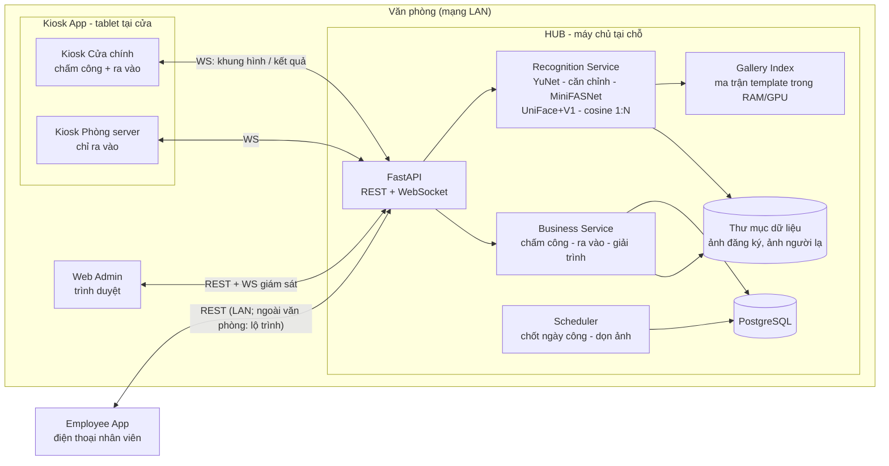
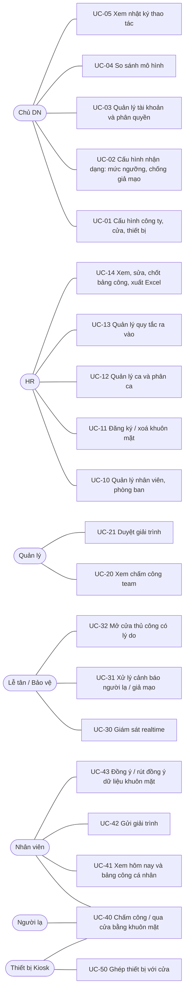
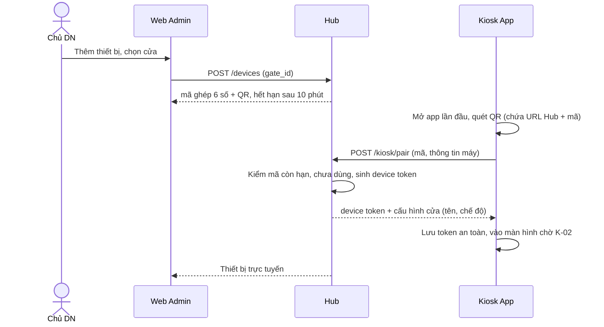
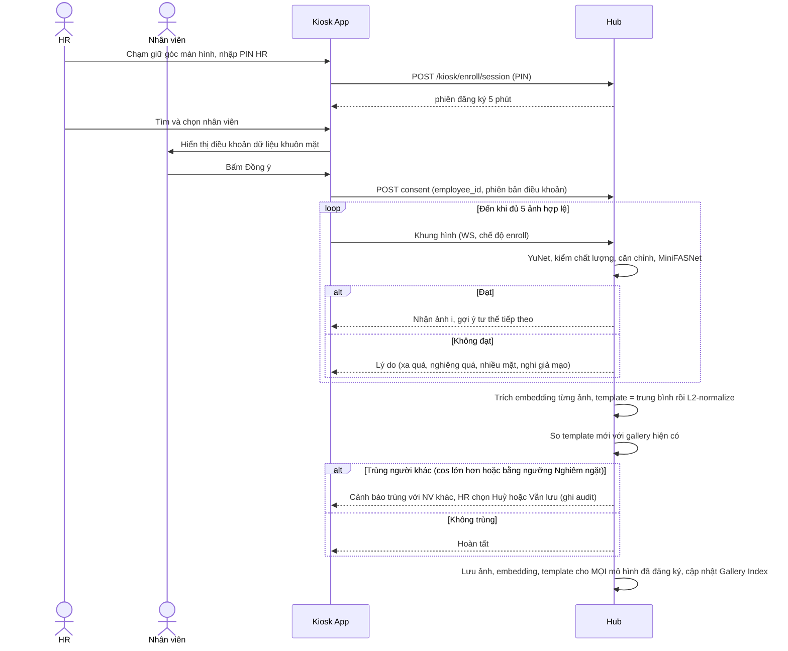
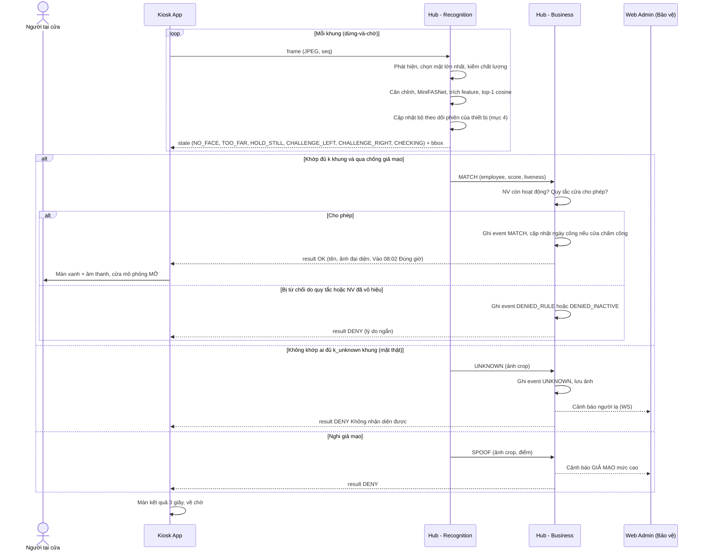
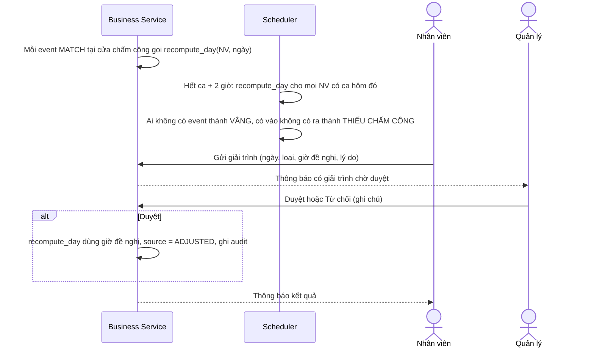
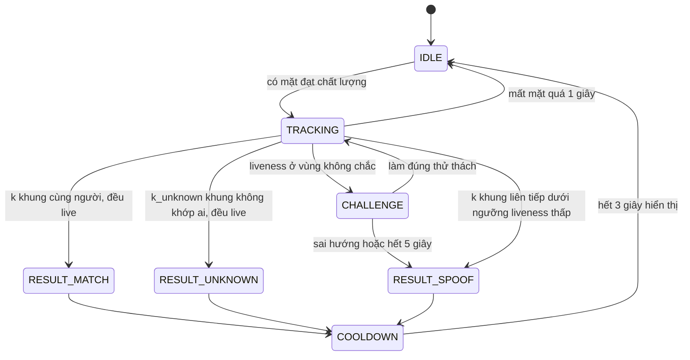
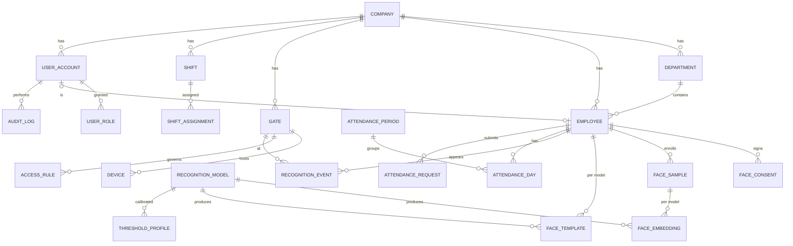

# THIẾT KẾ GĐ3 — LUỒNG, SƠ ĐỒ, DỮ LIỆU, MÀN HÌNH
> Session thiết kế app, 14/11/2026. Dựa trên `03-app/docs/lich-su-thiet-ke/de-xuat-tong-the.md` (v2, An đã đồng ý). Trạng thái: **BẢN THIẾT KẾ, chờ An duyệt** → sau đó gộp vào đặc tả `03-app/dac-ta-app.md` (GĐ4).
> ⚠ Đã có review chéo (14/11): nhiều điểm đã thay đổi, xem `03-app/docs/lich-su-thiet-ke/xu-ly-review.md`; bản cuối sẽ là `dac-ta-app.md`.
> Sơ đồ viết bằng Mermaid (xem được trong VS Code/GitHub; xuất PNG cho quyển bằng mermaid-cli).
> Mọi tham số ghi "**[khởi đầu]**" là giá trị ban đầu do thiết kế đặt, sẽ chỉnh khi kiểm thử tại chỗ; KHÔNG phải số đo.

---

## 0. Quy ước
- Mã use case: `UC-xx`. Mã luồng: `F-xx`. Mã màn hình: `K-xx` (Kiosk), `E-xx` (Employee), `W-xx` (Web Admin).
- Múi giờ hệ thống: `Asia/Ho_Chi_Minh`. Mọi thời điểm lưu UTC trong CSDL, hiển thị theo giờ công ty.
- "Mô hình" trong tài liệu này = backbone UniFace+V1 s3 best.pt (triển khai) hoặc UniFace s3 best.pt (đối chứng). "Bộ phát hiện" = YuNet. "Bộ chống giả mạo" = MiniFASNet.

---

## 1. Kiến trúc tổng thể



**Nguyên tắc kiến trúc**
1. **Toàn bộ AI ở Hub.** Kiosk chỉ chụp và hiển thị → một pipeline duy nhất, trùng pipeline đánh giá BLUFR (YuNet + căn chỉnh `fr.align` + flip-cộng).
2. **Dùng lại code thực nghiệm dạng chỉ-đọc:** Hub import `fr.align` (YuNetDetector, norm_crop) và định nghĩa backbone R18 + `extract_embeddings(flip=True)` từ bản sao của `02-thuc-nghiem/code/fr` đặt ở `03-app/hub/vendor/fr/`, kèm file SHA-256 của từng file nguồn. Parity test (mục 9) chứng minh không đổi cách trích feature.
3. **Sự kiện là dữ liệu gốc, ngày công là dữ liệu dẫn xuất.** `recognition_event` chỉ thêm, không sửa nội dung nhận dạng. `attendance_day` luôn tính lại được từ sự kiện + giải trình đã duyệt (hàm `recompute_day`, idempotent).
4. **Một hàng đợi GPU.** Mọi khung hình từ các kiosk đi qua một worker suy luận duy nhất (tránh tranh chấp 4GB VRAM). Kiosk gửi theo kiểu **dừng-và-chờ**: chỉ gửi khung tiếp theo sau khi nhận phản hồi, nên tốc độ tự khớp với Hub, không dồn hàng.

---

## 2. Actor và Use case



**Ma trận quyền (R = xem, W = sửa, — = không)**

| Chức năng | Chủ DN | HR | Quản lý | Bảo vệ | Nhân viên |
|---|---|---|---|---|---|
| Công ty, cửa, thiết bị | W | R | — | R | — |
| Cấu hình nhận dạng, So sánh mô hình | W | — | — | — | — |
| Tài khoản, phân quyền | W | W (trừ Chủ DN) | — | — | — |
| Nhân viên, phòng ban | W | W | R (team) | R (tên, ảnh) | R (bản thân) |
| Khuôn mặt | W | W | — | — | R (trạng thái của mình), rút đồng ý |
| Ca, phân ca, quy tắc cửa | W | W | R (team) | R | R (ca của mình) |
| Bảng công | W | W, chốt | R (team) | — | R (bản thân) |
| Giải trình | duyệt | duyệt | duyệt (team) | — | tạo, huỷ (của mình) |
| Giám sát, cảnh báo, mở thủ công | W | R | — | W | — |
| Sự kiện nhận dạng | R | R | R (team) | R | R (bản thân) |
| Nhật ký thao tác | R | — | — | — | — |

Phạm vi "team" = nhân viên thuộc phòng ban mà người đó được gán làm quản lý (`user_role.scope_department_id`).

---

## 3. Các luồng chính

### F-01 Ghép thiết bị Kiosk (UC-50)

- Device token chỉ có quyền: mở WS nhận dạng của đúng cửa đó + API đăng ký khuôn mặt khi có PIN HR. Thu hồi thiết bị = vô hiệu token.

### F-02 Đăng ký khuôn mặt tại Kiosk (UC-11, UC-43)

- **[khởi đầu]** 5 ảnh, tư thế gợi ý: thẳng, hơi trái, hơi phải, hơi ngẩng, hơi cúi (góc nhỏ). Ảnh căn chỉnh 112×112 lưu PNG.
- Embedding được tính cho **cả hai mô hình** (V1 và UniFace) để trang So sánh mô hình dùng được; Gallery Index vận hành chỉ dùng mô hình đang `is_active`.

### F-03 Nhận dạng tại cửa — chấm công + ra vào (UC-40, lõi hệ thống)


### F-04 Tổng hợp ngày công và giải trình (UC-14, UC-21, UC-42)


### F-05 Chốt công tháng (UC-14)
HR mở kỳ công tháng → xem lưới **nhân viên × ngày** → xử lý ngày bất thường (thiếu chấm công, giải trình còn chờ) → **Chốt**: kỳ chuyển `LOCKED`, mọi `attendance_day` trong kỳ `locked = true`, giải trình mới cho kỳ đã chốt bị chặn → **Xuất Excel** (sheet tổng hợp + sheet chi tiết). Mở khoá: chỉ Chủ DN, bắt buộc lý do, ghi audit.

### F-06 Cảnh báo và mở cửa thủ công (UC-30–32)
Màn hình giám sát W-10 nhận WS: luồng sự kiện mới nhất của tất cả cửa + danh sách cảnh báo chưa xử lý. Bảo vệ mở cảnh báo → xem ảnh crop, điểm, thời gian, cửa → chọn **Đã xử lý / Báo động giả / Là nhân viên (gắn đúng người)** + ghi chú. "Là nhân viên" KHÔNG tự thêm ảnh vào hồ sơ khuôn mặt (tránh đầu độc gallery), chỉ dùng để thống kê từ chối nhầm. Mở cửa thủ công: chọn cửa + lý do bắt buộc → event `MANUAL_OPEN`.

---

## 4. Thuật toán quyết định trên mỗi thiết bị

**Trạng thái phiên Kiosk**


**Giả mã (chạy ở Hub cho từng device_id)**
```
mỗi khung f:
  faces = YuNet(f, score ≥ 0.6)                       # cùng ngưỡng align_lfw.py
  nếu rỗng: mất_mặt += dt; nếu mất_mặt > 1s → reset; trả NO_FACE
  face = mặt có bbox lớn nhất
  kiểm chất lượng: cạnh bbox ≥ 80 px [khởi đầu]; |yaw_ratio| ≤ 0.35 (trừ khi đang CHALLENGE) → nếu fail trả TOO_FAR / HOLD_STILL
  nếu bbox lệch nhiều so với khung trước (IoU < 0.3) → coi là người khác → reset bộ đếm
  p_live = MiniFASNet(f, bbox)
  x = norm_crop(f, landmarks) → emb = L2(B(x) + B(flip x)) → (id*, s*) = argmax cos(emb, G)
  # liveness
  nếu p_live < L_low   → spoof_streak++ ; nếu spoof_streak ≥ k → SPOOF
  nếu L_low ≤ p_live < L_high và chưa qua thử thách → vào CHALLENGE (hướng ngẫu nhiên trái/phải)
  # nhận dạng
  nếu s* ≥ τ:  nếu id* == ứng_viên: streak++ ngược lại ứng_viên = id*, streak = 1
  ngược lại:   unknown_streak++ ; streak = 0
  nếu streak ≥ k và (mọi khung trong streak có p_live ≥ L_high hoặc đã qua thử thách) → MATCH(ứng_viên, điểm TB)
  nếu unknown_streak ≥ k_unknown và các khung đều live → UNKNOWN
```
**Thử thách quay đầu:** `yaw_ratio = (x_mũi − x_giữa_hai_mắt) / khoảng_cách_hai_mắt` (từ 5 landmark YuNet; ảnh camera trước đã lật gương nên quy đổi hướng tại Kiosk). Đạt khi `yaw_ratio` vượt ±0.25 **[khởi đầu]** đúng chiều yêu cầu trong 5 giây, bbox liên tục (IoU ≥ 0.3 giữa các khung) để chắc vẫn là cùng một người.

**Tham số [khởi đầu]** (lưu ở `company.settings`, Chủ DN chỉnh tại W-14):

| Tham số | Giá trị | Ghi chú |
|---|---|---|
| τ (ngưỡng nhận dạng) | mức Nghiêm ngặt ≈ 0,466 | từ log BLUFR, xem đề xuất v2 mục 5 |
| k (khung khớp liên tiếp) | 3 | ~1 giây ở 3–4 khung/giây |
| k_unknown | 6 | cho người đã đăng ký thêm cơ hội trước khi bị coi là lạ |
| L_low / L_high (liveness) | 0,5 / 0,9 | đặt theo thang điểm "real" của MiniFASNet; **phải hiệu chỉnh** bằng kiểm thử ảnh in/màn hình |
| Cooldown cùng NV cùng cửa | 60 giây | trong cooldown vẫn hiện "Đã ghi nhận lúc …", không ghi event mới |
| Cooldown cảnh báo người lạ / cửa | 15 giây | chống spam |
| Tốc độ gửi khung | tối đa 4 khung/giây, cạnh dài 640 px, JPEG q=80 | |
| Thời gian hiển thị kết quả | 3 giây | |

> Ghi chú cho quyển: k, cooldown, thử thách là **logic ứng dụng**, không thuộc mô hình; τ là ngưỡng vận hành lấy từ log BLUFR.

---

## 5. Quy tắc nghiệp vụ chi tiết

### 5.1 Ra vào (sau khi có MATCH)
1. `employee.status ≠ ACTIVE` → `DENIED_INACTIVE`.
2. Cửa có quy tắc: duyệt `access_rule` của cửa theo thứ tự ưu tiên **cá nhân > phòng ban > mặc định cửa**; khớp ngày-trong-tuần và khung giờ → `allow` theo quy tắc. Không quy tắc nào khớp → theo `gate.default_policy` (`ALLOW_ALL_ACTIVE` cho cửa chính, `DENY` cho cửa hạn chế).
3. Được phép → event `MATCH`, `door_action = OPEN` (mô phỏng). Không → `DENIED_RULE`.

### 5.2 Chấm công (chỉ cửa chế độ ATTENDANCE_ACCESS, chỉ event MATCH được phép)
- **Ngày công** = ngày của ca (MVP: ca không qua nửa đêm, nên = ngày địa phương).
- **Cửa sổ nhận event:** từ `start − 3h` đến `end + 4h` **[khởi đầu]**; event ngoài cửa sổ chỉ là ra vào, không tính công.
- `check_in` = event sớm nhất; `check_out` = event muộn nhất **và cách check_in ≥ 30 phút** [khởi đầu]; nếu không có event như vậy thì chưa có giờ ra.
- Trạng thái (tính theo thứ tự):

| Trạng thái | Điều kiện |
|---|---|
| `LEAVE` | HR đánh dấu nghỉ |
| `OFF` | không có ca hôm đó |
| `ABSENT` | đã qua thời điểm chốt ngày, không có check_in |
| `MISSING_OUT` | đã qua thời điểm chốt ngày, có check_in, không có check_out |
| `IN_PROGRESS` | trong ngày, đã vào, chưa ra |
| `NORMAL` / `LATE` / `EARLY` / `LATE_EARLY` | `late = check_in > start + grace_in`; `early = check_out < end − grace_out` |

- `late_minutes`, `early_minutes`, `worked_minutes` (trừ nghỉ trưa) tính kèm.
- Giải trình đã duyệt ghi đè giờ tương ứng → `source = ADJUSTED`, giữ tham chiếu event gốc.
- Kỳ công đã chốt → `recompute_day` không ghi đè (chỉ log cảnh báo).

### 5.3 Giải trình
Loại: `FORGOT_IN`, `FORGOT_OUT`, `NOT_RECOGNIZED`, `BUSINESS_TRIP`, `OTHER`. Trạng thái: `PENDING → APPROVED | REJECTED | CANCELLED` (NV huỷ khi còn PENDING). Người duyệt: quản lý phòng ban; phòng ban không có quản lý → HR. Hạn gửi: trong kỳ công chưa chốt.

---

## 6. Mô hình dữ liệu



**Bảng chi tiết** (mọi bảng nghiệp vụ có `id` UUID, `company_id`, `created_at`, `updated_at`; kiểu `vec512` = `real[]` 512 phần tử):

| Bảng | Cột chính | Ghi chú |
|---|---|---|
| `company` | name, timezone, settings (jsonb: τ-level, k, cooldown, L_low/L_high, retention_days…) | MVP 1 dòng |
| `department` | name, manager_user_id? | |
| `employee` | code (mã NV, duy nhất), full_name, email, phone, department_id, status `ACTIVE/INACTIVE`, joined_at, avatar_sample_id? | |
| `user_account` | email (duy nhất), password_hash (argon2), status, employee_id?, last_login_at | |
| `user_role` | user_id, role `OWNER/HR/MANAGER/SECURITY/EMPLOYEE`, scope_department_id? | một user nhiều vai trò |
| `face_consent` | employee_id, terms_version, accepted_at, revoked_at?, collected_by_user_id, device_id? | rút đồng ý → xoá sample/embedding/template |
| `face_sample` | employee_id, image_path (PNG 112×112 đã căn chỉnh), det_score, yaw_ratio, liveness_score, captured_by_device_id, enroll_session_id | |
| `recognition_model` | name, backbone, checkpoint_path, checkpoint_sha256, embedding_dim=512, t_bs (b̃/s), is_active, role `PRODUCTION/COMPARISON` | 2 dòng: V1 s3, UniFace s3 |
| `face_embedding` | sample_id, model_id, vector vec512 | |
| `face_template` | employee_id, model_id, vector vec512, n_samples | = L2(mean) |
| `threshold_profile` | model_id, level `BALANCED/STRICT/CUSTOM`, cos_threshold, fpir_target, source_ref (đường dẫn log + trường JSON) | chỉ ghi số có nguồn log |
| `gate` | name, mode `ATTENDANCE_ACCESS/ACCESS_ONLY`, default_policy `ALLOW_ALL_ACTIVE/DENY`, threshold_level, is_active | |
| `device` | gate_id, name, pairing_code_hash, pairing_expires_at, token_hash, status `PENDING/ACTIVE/REVOKED`, last_seen_at, app_version | |
| `shift` | name, start_time, end_time, break_start?, break_end?, grace_in_min, grace_out_min | MVP: không qua nửa đêm |
| `shift_assignment` | shift_id, employee_id? hoặc department_id?, weekdays int[], effective_from, effective_to? | cá nhân ưu tiên hơn phòng ban |
| `access_rule` | gate_id, employee_id? / department_id?, weekdays int[], time_from, time_to, allow bool, priority | |
| `recognition_event` | gate_id, device_id?, occurred_at, result `MATCH/UNKNOWN/SPOOF/DENIED_RULE/DENIED_INACTIVE/MANUAL_OPEN`, employee_id?, model_id, top1_employee_id?, top1_score, threshold_used, liveness_min, challenge_used, n_frames, door_action `OPEN/NONE`, snapshot_path?, handled_status `NEW/RESOLVED/FALSE_ALARM/IS_EMPLOYEE`, handled_by?, handled_at?, note? | **append-only** cho phần nhận dạng; chỉ cột handled_* được sửa |
| `attendance_period` | month (YYYY-MM), status `OPEN/LOCKED`, locked_by?, locked_at?, unlock_reason? | |
| `attendance_day` | employee_id, work_date, shift_id?, check_in_at?, check_out_at?, check_in_event_id?, check_out_event_id?, status, late_min, early_min, worked_min, source `AUTO/ADJUSTED/MANUAL`, period_id, locked | duy nhất (employee_id, work_date) |
| `attendance_request` | employee_id, work_date, type, requested_in?, requested_out?, reason, status, reviewer_user_id?, reviewed_at?, review_note? | |
| `notification` | user_id, type, payload jsonb, read_at? | |
| `audit_log` | actor_user_id?, actor_device_id?, action, entity, entity_id, before jsonb, after jsonb, ip, at | ghi mọi thao tác ghi của admin |

**Lưu file** (thư mục dữ liệu Hub, cấu hình được): `faces/<employee_id>/<sample_id>.png`, `snapshots/<yyyy-mm-dd>/<event_id>.jpg`. Ảnh người lạ/giả mạo xoá sau `retention_days` (**[khởi đầu]** 30 ngày) bởi Scheduler. Ảnh khung hình đầy đủ KHÔNG lưu, chỉ lưu crop.

**Gallery Index:** khi khởi động và mỗi khi template/trạng thái NV thay đổi, Hub nạp ma trận `T (N×512)` của mô hình PRODUCTION cho NV `ACTIVE` có consent còn hiệu lực, lên GPU; so khớp = `T · emb`.

---

## 7. Giao tiếp (khung API — chi tiết ở GĐ4)

**WebSocket Kiosk** `/ws/kiosk` (xác thực bằng device token)

| Chiều | Thông điệp |
|---|---|
| Kiosk → Hub | `{type:"frame", seq, mode:"recognize"|"enroll", w, h}` + nhị phân JPEG |
| Hub → Kiosk | `{type:"state", seq, state, hint, bbox, challenge?}` |
| Hub → Kiosk | `{type:"result", result, employee?{name, code, avatar_url}, attendance?{kind:"IN"|"OUT"|"NONE", time, status}, door:"OPEN"|"DENY", message}` |
| Hub → Kiosk | `{type:"enroll_progress", accepted, total, reason?}` / `{type:"config", gate, mode}` |

**WebSocket giám sát** `/ws/monitor` (JWT, vai trò SECURITY/OWNER/HR): `{type:"event", …}`, `{type:"alert", …}`, `{type:"device_status", …}`.

**REST (nhóm)**: `/auth` (login, refresh, đổi mật khẩu) · `/me` (hôm nay, bảng công, giải trình, consent) · `/employees` · `/departments` · `/users` + `/roles` · `/faces` (danh sách sample, xoá, trạng thái) · `/kiosk/pair`, `/kiosk/enroll/session` · `/gates` · `/devices` · `/shifts`, `/shift-assignments` · `/access-rules` · `/events` (lọc, xử lý cảnh báo) · `/attendance/days` (lọc, sửa có lý do) · `/attendance/requests` (tạo, duyệt) · `/attendance/periods` (chốt, mở, xuất Excel) · `/settings/recognition` · `/models` + `/models/compare` (upload 1 ảnh → điểm top-1 của cả hai mô hình) · `/audit-logs`.

---

## 8. Màn hình

### 8.1 Kiosk App (tablet, xoay ngang)
| Mã | Màn hình | Nội dung chính |
|---|---|---|
| K-01 | Ghép thiết bị | Quét QR / nhập mã 6 số + URL Hub; báo lỗi rõ (hết hạn, sai mã, không tới được Hub) |
| K-02 | Chờ quét | Camera toàn màn hình, khung oval hướng dẫn, tên cửa, đồng hồ lớn, chỉ báo kết nối Hub; dòng gợi ý theo `state` ("Lại gần hơn", "Nhìn thẳng", "Giữ yên") |
| K-03 | Thử thách | Mũi tên lớn + "Quay mặt sang TRÁI/PHẢI", đếm ngược 5 giây |
| K-04 | Kết quả | **Xanh:** ảnh đại diện + tên + "Vào 08:02 · Đúng giờ" / "Ra 17:35" / "Mời vào"; **Đỏ:** "Không nhận diện được" hoặc lý do từ chối; **Cam:** "Đã ghi nhận lúc 08:02" (cooldown). Âm thanh khác nhau. 3 giây |
| K-05 | Đăng nhập HR | Chạm giữ góc 3 giây → nhập PIN |
| K-06 | Chọn nhân viên | Tìm theo tên/mã, hiển thị trạng thái khuôn mặt (chưa có / đã có n ảnh) |
| K-07 | Điều khoản | Nội dung đồng ý xử lý dữ liệu khuôn mặt, nút Đồng ý / Không đồng ý |
| K-08 | Chụp đăng ký | Camera + tiến độ 1/5…5/5 + gợi ý tư thế + lý do loại ảnh |
| K-09 | Kết quả đăng ký | Thành công / cảnh báo trùng người (Huỷ / Vẫn lưu) |
| K-10 | Cài đặt ẩn | (PIN) trạng thái Hub, phiên bản, huỷ ghép |
| K-11 | Mất kết nối | "Không kết nối được máy chủ — vui lòng báo lễ tân", tự thử lại |

### 8.2 Employee App (điện thoại, xoay dọc)
| Mã | Màn hình | Nội dung chính |
|---|---|---|
| E-01 | Đăng nhập | Email + mật khẩu; lần đầu bắt đổi mật khẩu |
| E-02 | Hôm nay | Thẻ lớn: ca hôm nay, **Giờ vào / Giờ ra** (hoặc "Chưa chấm công"), trạng thái (Đúng giờ / Muộn 7 phút), danh sách lượt qua cửa hôm nay |
| E-03 | Bảng công tháng | Lịch tháng tô màu theo trạng thái + tổng: ngày công, số lần muộn, phút muộn, ngày thiếu chấm công |
| E-04 | Chi tiết ngày | Giờ vào/ra, nguồn (tự động / đã giải trình), các event, nút "Giải trình" |
| E-05 | Gửi giải trình | Loại, giờ đề nghị, lý do |
| E-06 | Giải trình của tôi | Danh sách + trạng thái, huỷ khi còn chờ |
| E-07 | Thông báo | Kết quả giải trình, nhắc thiếu chấm công |
| E-08 | Hồ sơ & dữ liệu khuôn mặt | Thông tin cá nhân, trạng thái đăng ký khuôn mặt, ngày đồng ý, **Rút đồng ý** (cảnh báo: sẽ không chấm công bằng khuôn mặt được nữa) |
| E-09 | (Quản lý) Team hôm nay | Ai đã vào, ai muộn, ai chưa đến |
| E-10 | (Quản lý) Duyệt giải trình | Danh sách chờ, duyệt/từ chối kèm ghi chú |

### 8.3 Web Admin
| Mã | Màn hình | Vai trò | Nội dung chính |
|---|---|---|---|
| W-01 | Đăng nhập | tất cả | |
| W-02 | Tổng quan hôm nay | Chủ DN, HR | Thẻ số: có mặt / muộn / chưa đến / người lạ hôm nay; biểu đồ giờ đến; 10 sự kiện mới nhất |
| W-03 | Nhân viên | Chủ DN, HR | Bảng lọc theo phòng ban/trạng thái/đã có khuôn mặt; tạo, sửa, vô hiệu hoá; nhập từ Excel (lộ trình) |
| W-04 | Chi tiết nhân viên | Chủ DN, HR | Tab Thông tin · Khuôn mặt (ảnh mẫu, consent, xoá) · Ca · Lịch sử chấm công · Sự kiện |
| W-05 | Phòng ban | Chủ DN, HR | CRUD, gán quản lý |
| W-06 | Ca & phân ca | Chủ DN, HR | CRUD ca; phân ca theo phòng ban/cá nhân, ngày trong tuần |
| W-07 | Cửa & thiết bị | Chủ DN | CRUD cửa, chế độ, chính sách mặc định; thêm thiết bị → QR ghép; trạng thái online; thu hồi |
| W-08 | Quy tắc ra vào | Chủ DN, HR | Bảng quy tắc theo cửa |
| W-09 | Bảng công | Chủ DN, HR, Quản lý (R) | Lưới NV × ngày tô màu; bấm ô → chi tiết/sửa có lý do; chốt kỳ; xuất Excel |
| W-10 | Giám sát | Bảo vệ, Chủ DN, HR | Luồng sự kiện realtime theo cửa; cảnh báo chưa xử lý (người lạ, giả mạo) có ảnh crop; nút mở cửa thủ công |
| W-11 | Tra cứu sự kiện | Chủ DN, HR, Bảo vệ | Lọc theo thời gian/cửa/kết quả/NV; xem điểm, ngưỡng đã dùng, liveness |
| W-12 | Giải trình | Chủ DN, HR, Quản lý | Danh sách chờ duyệt, lịch sử |
| W-13 | Tài khoản & phân quyền | Chủ DN, HR | Tạo tài khoản, gán vai trò + phạm vi phòng ban |
| W-14 | Cấu hình nhận dạng | Chủ DN | Chọn mức ngưỡng (hiện ngưỡng cos + FPIR tham chiếu + nguồn log), k, cooldown, L_low/L_high, thời hạn lưu ảnh |
| W-15 | So sánh mô hình | Chủ DN | Tải ảnh hoặc chọn event → điểm top-1/top-5 của V1 và UniFace, vạch ngưỡng τ và b̃/s của từng mô hình |
| W-16 | Nhật ký thao tác | Chủ DN | Lọc theo người, hành động |

---

## 9. Kiểm thử bắt buộc trước khi xây tính năng (M0)
Lưu ở `03-app/hub/tests/` và kết quả ở `03-app/ket-qua-kiem-thu/<ngay>_<ten>/` (không đụng `02-thuc-nghiem/`).
1. **Parity embedding:** 100 ảnh đã căn chỉnh (lấy từ LFW aligned_u8 của lần test BLUFR) → embedding từ Hub so với `extract_embeddings(flip=True)` của code thực nghiệm, cùng checkpoint: max |Δ| ≤ 1e-5, cos ≥ 0,99999.
2. **Parity căn chỉnh:** 100 ảnh LFW gốc → ảnh căn chỉnh của Hub so với ảnh trong `aligned_u8.npy` của lần test: giống hệt hoặc chỉ lệch do chọn mặt (log lại).
3. **Checksum mô hình:** SHA-256 checkpoint khớp với `meta.sha256` trong `ket_qua_blufr_lfw.json`.
4. **Ngưỡng:** giá trị trong `threshold_profile` khớp trung bình `thr_DIR@…` đọc trực tiếp từ JSON (script sinh tự động, không gõ tay).

## 10. Yêu cầu phi chức năng (mục tiêu, sẽ ĐO chứ không giả định)
- Thời gian xử lý 1 khung tại Hub (RTX 3050): mục tiêu < 150 ms; từ lúc đứng trước camera đến kết quả: mục tiêu < 2 giây với người đã đăng ký.
- Đồng thời: 3 kiosk + 5 người dùng web.
- Bảo mật: mật khẩu argon2; JWT access 15 phút / refresh 7 ngày; device token thu hồi được; mọi API kiểm quyền theo vai trò + phạm vi; rate-limit đăng nhập và PIN.
- Mạng: MVP chạy HTTP trong LAN cho demo; **bản thương mại bắt buộc HTTPS** (lộ trình: CA nội bộ). Ghi rõ là hạn chế của bản demo.
- Quyền riêng tư: chỉ lưu crop, xoá theo thời hạn, consent có phiên bản, rút đồng ý xoá dữ liệu sinh trắc, audit log.
- Khả năng thay mô hình: thêm `recognition_model` mới → job trích lại embedding từ `face_sample` → chuyển `is_active`. Không sửa app.

## 11. Quyết định thiết kế cần An duyệt
1. Toàn bộ AI ở Hub, kiosk gửi khung kiểu dừng-và-chờ (mục 1).
2. Sự kiện append-only, ngày công là dữ liệu dẫn xuất tính lại được (mục 1, 5.2).
3. Bộ tham số [khởi đầu] ở mục 4 và quy tắc chấm công mục 5.2 (cửa sổ ca, 30 phút tối thiểu giữa vào và ra).
4. "Là nhân viên" khi xử lý cảnh báo KHÔNG tự thêm ảnh vào hồ sơ (chống đầu độc gallery).
5. Lưu embedding cho cả hai mô hình để phục vụ W-15.
6. MVP dùng HTTP trong LAN, HTTPS để lộ trình.
